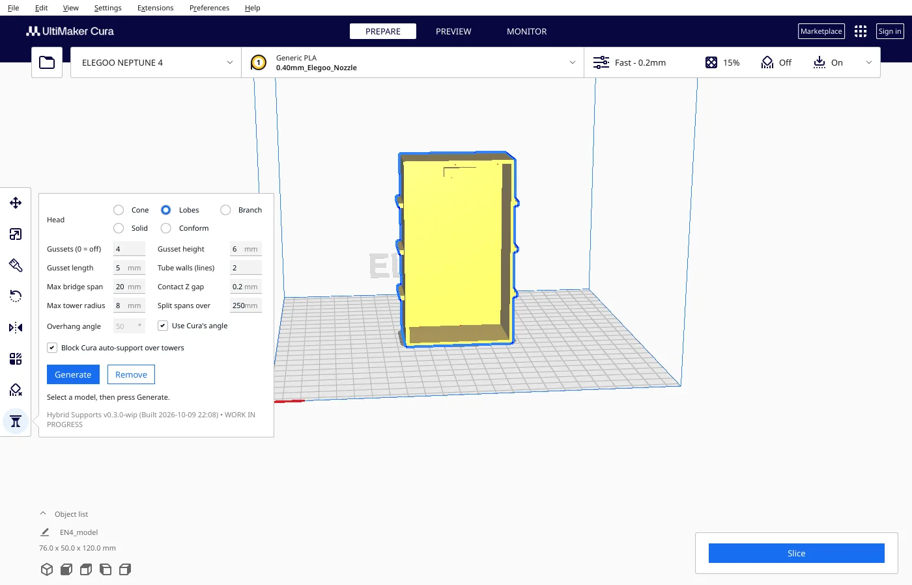
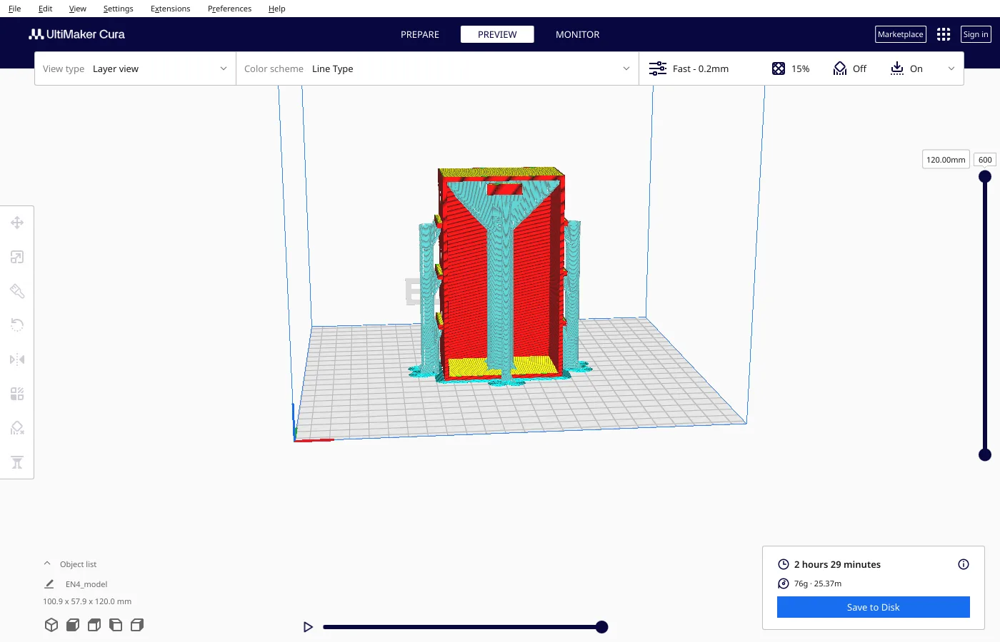
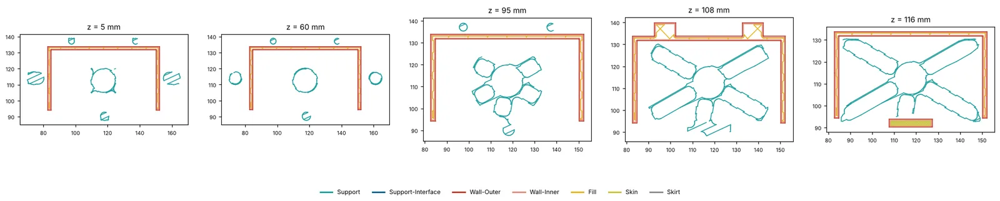
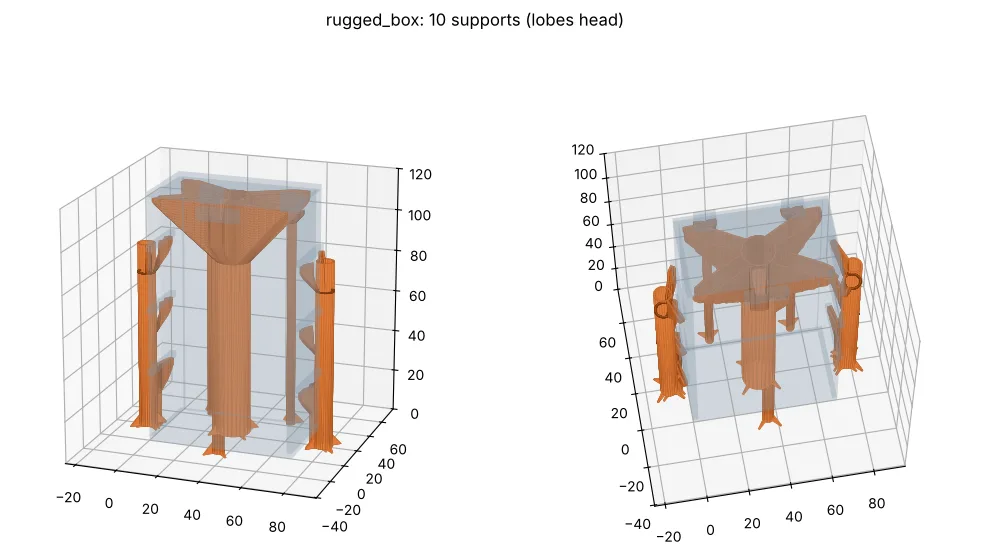
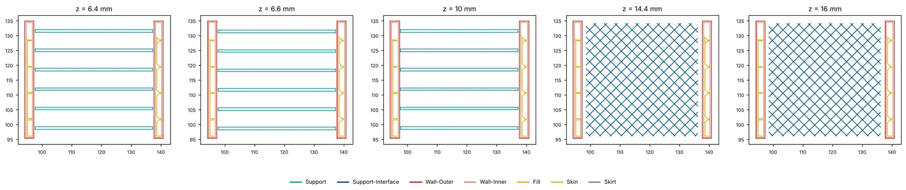
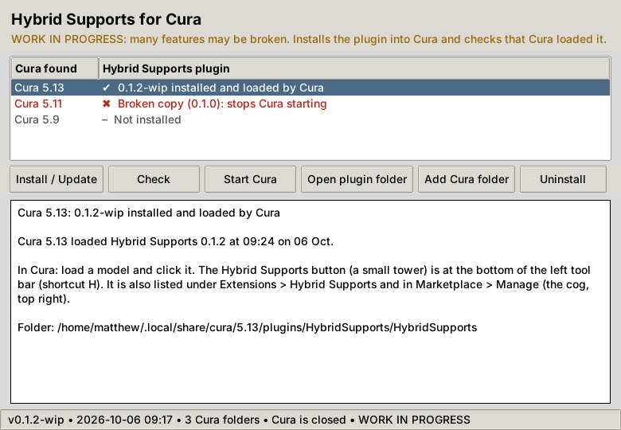
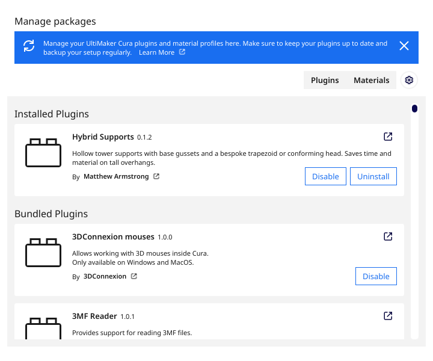
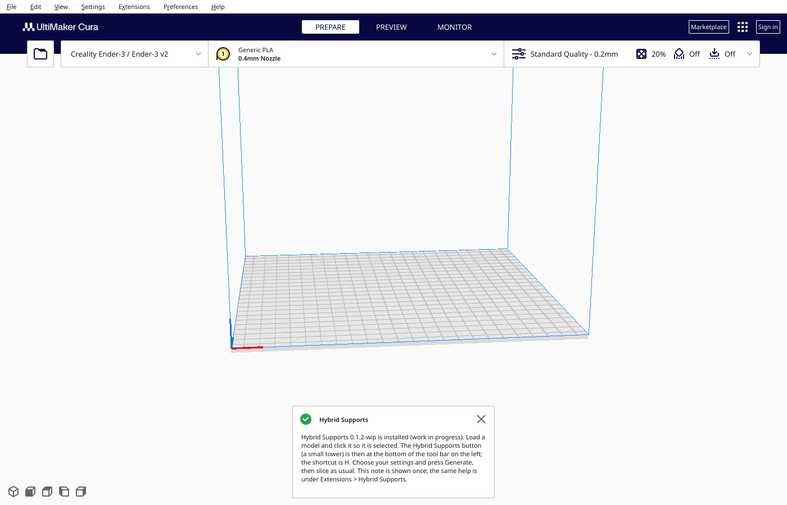
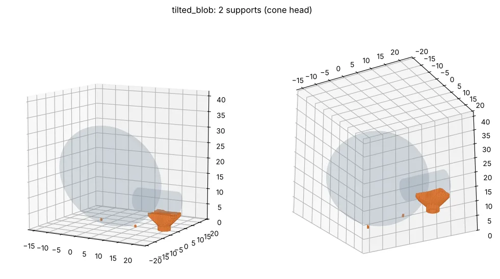
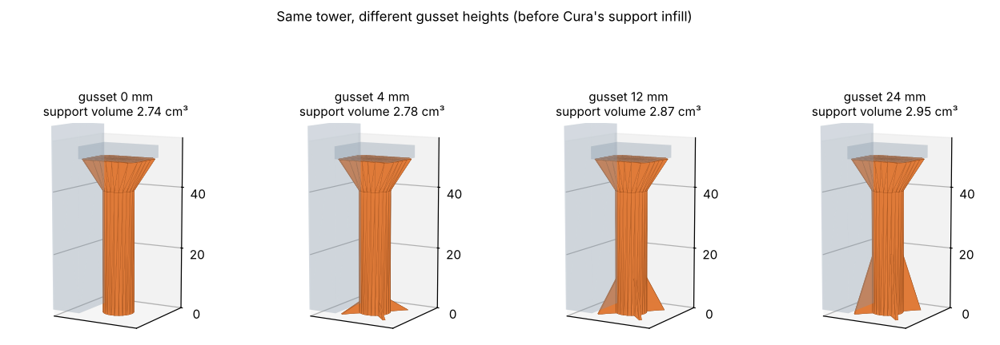

# Hybrid Supports for UltiMaker Cura

> **WORK IN PROGRESS: MANY FEATURES MAY BE BROKEN** (proof of concept, `0.6.6-wip`)
>
> Sliced inside Cura 5.13.0 (Linux AppImage) with the **Elegoo Neptune 4** profile. **Not yet test-printed.** Windows and macOS untested. Coming from 0.1.x? See [What changed](#what-changed-since-01).

**Licence:** [PolyForm Noncommercial 1.0.0](LICENSE.md). Source-available, free for personal and other non-commercial use; commercial use needs permission. Provided as-is, with no warranty and no liability. This is not legal advice.

A Cura tool plugin that supports tall overhangs with **one hollow pillar per overhang** instead of a forest of solid columns. Each pillar stands on a clear spot (the plate or the model), has **base gussets** that are kept clear of the model, and ends in a **hollow star of lobes**: a pseudo-cone whose arms flare out at 45° towards the corners of the overhang. Every layer is one closed outline, and the gaps between the lobes are short enough to bridge; extra lobes are added only where a bridge would be too long. A plain hollow cone with spokes inside is still there as an option.





<sub>Cura 5.13.0 screenshots of a synthetic test part shaped like an "EN4 Rugged Box" (70 × 40 × 120 mm, standing on end, open on one side, with ribs, hinge knuckles and a latch lug), taken on a headless test machine with software rendering.</sub>

## What a real slice looks like

Five layers from the gcode Cura 5.13 produced for that box (Elegoo Neptune 4 profile, 0.2 mm, *Generate Support* off, Support Wall Line Count 0):



Low down every support is a hollow ring. Higher up, hollow lobes grow out of the centre ring, and just under the ceiling they reach the four corners, with a fifth, shorter lobe towards the open front edge (the only edge not resting on a wall). Each lobe prints as a closed loop, even with Cura's default of 0 support walls. An automated check confirmed that every pillar prints on 100 % of its layers (the 0.1.x "tube in mid-air" problem).

### How it compares (the box above, Cura 5.13 estimates, Neptune 4 profile)

| Support for the same box | Print time | Support filament |
|---|---|---|
| **Hybrid Supports, Lobes head** (default, support walls 0) | **149 min** | **4.9 m** |
| Hybrid Supports, Cone head with cross | 151 min | 5.4 m |
| Lobes with Support Wall Line Count 1 | 168 min | 7.5 m |
| Cone with Support Wall Line Count 1 | 169 min | 7.8 m |
| Cura tree support | 151 min | 6.5 m |
| Cura normal support | 190 min | 22.3 m |

<sub>These numbers are from 0.3, when the towers were Cura support meshes. Since 0.6.1 Lobes, Cone and Branch print as hollow walls (see below); they have not been re-measured on the box.</sub>

On this part the Lobes head uses about 78 % less support filament than Cura's normal support and saves about 40 minutes. Against Cura's **tree** support it is about 25 % less support filament and about the same time. Against the cone it saves about 10 % of the support filament and a minute. 1 support wall costs about 18 minutes and isn't needed for the lobes. These are Cura's own estimates for one synthetic part; nothing here has been printed, and tree support may well do better on other shapes.



📄 **The research paper:** [*Putting Plastic on a Pedestal: experimental methods of plastic waste reduction for 3D printing*](docs/paper/putting-plastic-on-a-pedestal.pdf) (a defensive publication describing these supports; physically untested; its own repository is [putting-plastic-on-a-pedestal](https://github.com/The-Dorkknight/putting-plastic-on-a-pedestal)).

### New in 0.6.4: big parts, measured

Sliced on 200 x 200 mm parts with long stems (Cura 5.13, Neptune 4; not yet printed): Hybrid lobes use 84 % less support plastic than Cura's normal support on a 150 mm-tall part, and 24 to 26 % less than Cura's tree support (but 29 % more than tree on a 50 mm-tall part, so the saving is a tall-part effect). Full table in [docs/RESEARCH.md](docs/RESEARCH.md) section 16. Also fixes cone shells that flared past the edge of big overhangs.

### New in 0.6.3: an interface cap on every support

From the review of 0.6.2: the towers had no support interface, so the part's underside would have printed straight onto a few walls and drooped between them. Every Lobes, Cone, Branch, Solid and Conform support (and Tethers that fall back to lobes) now gets the same **4-layer cap stack as the tethers**, 0.8 mm under the overhang:

1. a lattice (3 mm spacing) bridging between the tower's walls, printed at *Bridge speed* (20 mm/s) with the fan at 100 %,
2. a second lattice the other way,
3. a full layer of concentric rings at 50 %,
4. a solid (100 %) layer, then the usual contact gap (0.2 mm) and the part.

The towers now stop at the cap's underside, so the first lattice bonds straight onto them. The cap is its own small mesh (*HybridCap*), printed as solid skin in Cura's preview; the lattice / rings / solid layers are written into the G-code when you **Save to Disk** or send to the printer, as for the tethers (untick *Cap stack* to keep plain solid layers). Nothing in your Cura profile is changed for it. A sloped or curved underside gets a staircase of flat caps, one per 0.8 mm of height; where a cap can't fit (an overhang less than about 1.4 mm above what's under it, a steep curved underside, or no room clear of the model) there is none, and the tower reaches the underside as before. On the six-part plate Cura's estimate went from 2 h 14 min to 2 h 21 min, about 0.2 m more plastic per part.

### New in 0.6.2: wide rounded lobes with filleted joins

From the review of the 0.6.1 top view: the thin walls met at the centre in sharp notches (stress raisers), and each was a 2-line slab whose two lines sit 0.4 mm apart, so it bends easily sideways when the nozzle drags across it. The Lobes support built to size is now **one star of a few wide rounded lobes** (8 mm wide by default, `lobe_width`), printed hollow with 2 walls (*Tube walls*). The two walls of each lobe are about 8 mm apart, so it is far stiffer sideways, and the lobes blend into each other with rounded inner corners (at least 3 mm, `lobe_fillet`) instead of notches. Being wider, fewer are needed: **4 lobes** on the 40 mm channel and corner, where 0.6.1 had 6 walls. Each lobe still stands on the bed as far out as it must and flares at 45° to the overhang's edges.

Branch and the Cone's ribs stay thin straight webs (that's what those heads are), but their centre now has a rounded hub, so they no longer meet in a sharp notch either.

On the six-part plate (Cura 5.13, Neptune 4, measured as in 0.6.1): channel lobes 0.73 m (0.6.1: 0.65 m), corner lobes 0.65 m (0.57 m), so about 0.08 m more plastic each for the stiffer shape. The curved outlines take more, shorter moves (about 15,000 against 3,600 per part). Cura's estimate for the whole plate went from 2 h 6 min to 2 h 14 min, partly from Branch, which now prints its 3-line webs solid (2 walls) instead of as a loop with a gap.

### New in 0.6.1: hollow walls, and one tower where 0.6.0 made four

From the first look at 0.6.0 in Cura on the Neptune 4:

- **The towers print as hollow walls, not zig-zag.** Cura fills a support mesh with the support pattern, and with the Neptune 4's *Support Wall Line Count* of 0 that is one zig-zag line with no outline (Cura won't let a plugin change support walls or pattern for one mesh). 0.6.0 made the walls about 3 mm thick to stop them going missing, and they printed as a zig-zag inside a 3 mm strip. Now every Lobes, Cone and Branch support (and the standing webs) is added as a **normal printed mesh** with its own settings: one wall round every outline, no infill, no top or bottom skin, printed at your support speed and flow. A 2-line wall prints as one closed loop, the tube as two rings, the lobes as closed loops. Tethers and the Solid/Conform heads stay Cura support meshes (they need the roof and the concentric pattern). In Cura's preview the towers show in the wall colour, not the support colour.
- **One tower instead of 4, 8, 16 or 32.** When the overhang needed one support built to size, 0.6.0 asked for a clear round foot as wide as the reach (it hit the legs of a channel), and any support standing on a surface instead of the bare bed (a base plate under the part, a brim block, a floor of the model) saw that surface as "model above the wall", built nothing and split the overhang again and again. Now each wall of the criss-cross stands on the floor along its own line as far out as it must, and only a small foot round the centre has to be clear. On a channel or corner 8 to 25 mm high, 30 to 60 mm wide and 40 to 80 mm long, standing on a base plate, every head now makes 1 support (0.6.0: 1 to 32).
- On the six-part plate (Cura 5.13, Neptune 4): channel lobes 0.65 m of filament and 3,600 moves (0.6.0: 0.78 m, 8,500), channel branch 0.64 m and 3,000 (0.77 m, 8,500), corner lobes 0.57 m and 2,700 (0.66 m, 7,900); the cones are about the same (1.30 m, 21,700 moves). Measured from the G-code between the legs, so these include a little of the parts' own first layers.

### One criss-cross built to size (Lobes and Branch)

When one normal-sized tower can't reach the whole overhang within the 45° flare (a 40 x 40 mm roof only 15 mm up, say), Lobes and Branch build one support to fit instead of several towers: thin walls (2 lines thick for Lobes, *branch lines* for Branch) from one centre point with **no hub**, each standing on the floor along its own line as far out as it must and then flaring out at 45° to the edge of the overhang. The first go to the corners (a criss-cross); more are added only where a bridge would be longer than *Max bridge span*, counting edges that rest on a wall of the model as supported. On the 40 mm test channel that is 6 walls (four to the corners, two to the open ends) and 0.58 m of support, against 1.21 m for four lobes towers. Bigger overhangs still split. (`lobes_one_tower` in the settings turns it off.) **Cone** does the same with one thin cone (a 2-line wall from a circle on the bed, flaring to the overhang's edges) round an X of ribs to the corners: on the channel 0.92 m of support against 0.58 m for the criss-cross, and about 2.5 times the moves, so it may be dropped after the test print.

### Experimental: Tethers

Instead of a pillar from the floor, **Tethers** strings strips of support between two walls of the model a short way under the overhang (10 mm by default), and puts a 4-layer cap on top (see below). The idea comes from failed supports: the loose "fuzz" catches on nearby walls and builds up into something solid.

- **Tethers:** straight strips from wall to wall. The first and last sit at the two ends of the overhang (0.2 mm in from the edge), the rest evenly between, covering about 20 % of the space. Each prints as a pair of straight lines, so its first layer is a proper bridge. Every other layer is shifted half a line width, so the layers only half overlap and snap apart easily. Cura can't do that shift from the shape (see [docs/RESEARCH.md](docs/RESEARCH.md) section 10), so the plugin shifts those lines in the G-code when you **Save to Disk** or send to the printer. Cura's preview shows the strips without the shift.
- **Dropped after the first sliced test plate (0.6.0):** stepped tethers (no advantage over straight ones), the spiderweb (left large regions unsupported) and radial tethers (the fan plus a lobes tower for the far corner was the worst of both; one lobes tower built to size does the job). Their notes stay in docs/RESEARCH.md.
- **Slow first layers:** the first three tether layers (0.6.5; was two, in case the first are weak or slack) are treated as bridges in mid-air, and Cura prints support at the profile's support speed (165 mm/s on the Neptune 4). On save, the plugin slows those layers to *Bridge speed* (20 mm/s by default; 0 turns this off) with the part fan at 100 %, then puts speed and fan back. This adds about a minute that Cura's time estimate doesn't show.
- **The cap** is kept clear of the walls by your normal X/Y distance. Only the strips touch the walls.
- **The cap stack** (0.8 mm, 4 layers, written into the G-code when you save, so Cura's preview shows ordinary roof lines instead): a lattice across the tethers (3 mm spacing, first layer at *Cap flow*, 85 % by default, so the hot bead fuses with the thin tether instead of squashing it), a lattice along them, one full layer of concentric rings at 50 % fill, then a solid (100 %) diagonal layer, so the part's underside comes off a smooth, flat surface. Untick *Cap stack* in the panel to go back to Cura's plain roof.
- **Test prints first:** `test-prints/` has one Neptune 4 G-code with every head on a 40 mm channel and corner, with what to look for ([test-prints/README.md](test-prints/README.md)).



- It only works where an overhang has walls on two opposite sides, no more than 110 mm apart (warning over 90 mm, falls back to lobes past 110). Anything else, such as the box's outside ribs, falls back to lobes automatically, and the status line says so.
- **It changes some of Cura's own settings,** because Cura only lets you set them for the whole print, not per support:
  - *Support X/Y Distance* goes to 0. Cura keeps every support that far from the walls, so otherwise the strips stop short. The plugin's other supports and the cap keep their own clearance in their shape.
  - *Support Roof* is turned on, 0.8 mm thick (the cap stack's four layers; 2 mm with the stack off).
  - *Support Pattern* goes to concentric, so every strip prints as an outline of its own shape, and *Support Infill Line Directions* is set along the strips.
  - **Remove** puts them all back. (Undoing a Remove brings the meshes back but not the settings; press Generate again.)
- The strips touch the walls, so expect small marks where they break off.
- **Not printed successfully yet.** The first test (stepped tethers on the old test box) showed the strips were too sparse and the roof touched the walls; both were fixed in 0.5.0, and the cap stack and slow-bridge step are new in 0.6.0. Whether the first mid-air layer holds at your printer's support speed is still the big unknown.

## What changed since 0.1

From the 0.1.x feedback on the EN4 Rugged Box:

| 0.1.x problem | Now |
|---|---|
| Tubes printed only in places, in mid-air | Cura profiles that drop small support areas (Elegoo's: 3 mm²) were deleting thin tube layers. Each support mesh now turns that off for itself only. Every pillar also checks it has a clear column down to a flat landing. |
| Big gussets stuck into the print | Every gusset is shortened until it is clear of the model and still stands on something. |
| No pillar in the middle of the box | Pillar positions are searched for a clear column that can see the overhang. |
| Three pillars across one wide gap | One pillar per overhang. It only splits when the cone can't reach (default over 250 mm). |
| Slat branches were slow | 0.2 made the default head a hollow cone with a cross inside. 0.3 replaces that default with hollow lobes (your idea): cheaper, and every layer is one closed loop. Cone and Branch are still options. |

## How it works (short)

1. Select a model and press **H** (or click the Hybrid Supports tool on the left toolbar).
2. Press **Generate**. For every overhang the plugin:
   - finds one spot where a pillar can stand with a clear column down to the plate or the model,
   - builds a hollow tube with gussets at its foot, trimmed to stay clear of the model,
   - builds a hollow star of lobes that flare (at most 45°) from the tube out to the corners of the overhang, adding lobes until no bridge is longer than *Max bridge span* (edges that rest on a wall of the model count as support),
   - gives low overhangs (6 mm or less) thin standing webs instead,
   - adds a thin **support blocker** over the overhang so Cura's own automatic support doesn't fill the same area again.
3. Slice as usual. Lobes, Cone and Branch supports are added as **normal printed meshes** set to print as hollow walls (one wall, no infill, no top or bottom, at your support speed and flow); Tethers and the solid heads are Cura **support meshes**. Either way they print even when *Generate Support* is off.

The full explanation is in [HOW_IT_WORKS.md](HOW_IT_WORKS.md); the research behind it is in [docs/RESEARCH.md](docs/RESEARCH.md).

## Install

You need **UltiMaker Cura 5.x** and **Python 3.8+**. Download the source (green **Code** button > Download ZIP, or the zip from the [Releases page](https://github.com/The-Dorkknight/cura-hybrid-supports/releases)), unzip it, close Cura, then double-click the launcher for your system:

| System | Double-click | Notes |
|---|---|---|
| Linux | `Install-Linux.sh` | Choose **Run** if the file manager asks. Tested on an Ubuntu 24.04 base (the same base as Linux Mint 22). Without `python3-tk` it falls back to a text version. |
| Windows | `Install-Windows.bat` | Needs Python from python.org. **Not yet tested on Windows.** |
| macOS | `Install-Mac.command` | First time: right-click > Open, because it isn't signed. **Not yet tested on a Mac.** |



The installer window:

1. **Install / Update** builds the plugin and puts it into every Cura 5.x it finds (AppImage, normal install or Flatpak), replacing older copies, including the 0.1.0-wip one that stopped Cura starting. It reads the files back before saying it worked.
2. **Start Cura** starts Cura and watches Cura's log. The row turns green with a tick once Cura has actually loaded the plugin, or shows Cura's error if it didn't.
3. **Check** repeats that check at any time. **Uninstall** removes the plugin.

<sub>Installer screenshot taken on a headless Linux test machine against real Cura settings folders.</sub>

Terminal instead of a window: `python3 install.py --cli` (install and check), `--check`, `--uninstall`.

### Where is it in Cura?

Cura hides its left tool bar until a model is on the build plate, so an empty Cura shows no sign of a new tool. After installing you get:

- a one-time note when Cura starts (below),
- **Extensions > Hybrid Supports** in the menu bar,
- an entry under **Marketplace > the cog (Manage) > Installed Plugins**,
- and, once a model is loaded and selected, the tower button at the bottom of the left tool bar (shortcut **H**).





### Other ways to install

- **Cura package:** download `HybridSupports-<version>.curapackage`, drag it onto the Cura window, accept, restart Cura.
- **By hand:** unzip `HybridSupports-<version>-plugin.zip` into the `plugins` folder that **Help > Show Configuration Folder** opens, then restart Cura. Installed this way it works, but it is not on Cura's Marketplace list.

## Use

| Setting | What it does | Default |
|---|---|---|
| Head: Cone / Lobes / Tethers / Branch / Solid / Conform | **Tethers (experimental):** strips between walls just under the overhang, then a cap (see above). *Coverage*, *Bridge speed*, *Cap stack* and *Cap flow* are in the panel. **Lobes:** hollow star-shaped pseudo-cone with lobes to the corners; one hub-less criss-cross built to size where a normal tower can't reach. **Cone:** hollow inverted cone. **Branch:** separate slat fins. **Solid:** the 0.1 flat-topped head. **Conform:** solid head whose top follows the underside | Lobes |
| Inside the cone (Cone head only): Cross / Rings / None | **Cross:** spokes from the pillar to the corners of the overhang, plus extra spokes where bridges would be too long. **Rings:** concentric bands. **None:** bare cone | Cross |
| Max bridge span | Longest bridge you trust your printer with. Lobes adds lobes, Cross adds spokes and Rings adds bands until no bridge is longer (Branch: gap between fins) | 20 mm |
| Gussets (0 = off) | Number of fins at the pillar foot | 4 |
| Gusset height | How far up the pillar the fins reach (max half the pillar height) | 6 mm |
| Gusset length | How far the fins reach out. Fins that would hit the model are shortened automatically | 5 mm |
| Tube walls (lines) | Thickness of the hollow tube, in support line widths | 2 |
| Contact Z gap | Gap between the head top and the model | 0.2 mm |
| Max tower radius | Upper limit for the tube radius (it scales with how far the head has to reach). The lobe width follows it: 4–10 mm | 8 mm |
| Split spans over | Overhangs longer than this get more than one pillar | 250 mm |
| Overhang angle | Uses Cura's *Support Overhang Angle* by default, or your own | Cura's |
| Block Cura auto-support over towers | Adds the support blockers | On |

- **Remove** deletes the generated meshes for the selected model (or for all models if nothing is selected).
- Pressing **Generate** again replaces that model's previous supports.
- The generated meshes are children of the model, so they move with it. Re-generate after rotating or scaling.
- The status line tells you how many supports were made, which ones the model only lets the head reach partly, and when gussets were shortened.
- Since 0.6.1 the towers print as walls, so Cura's *Support Wall Line Count* and *Support Pattern* no longer matter for them (they still do for Tethers and the solid heads). To go back to support meshes, set `print_walls = False` in `hybrid_core.py`.
- Cura's *Support X/Y Distance* is respected: the plugin builds its meshes that far (plus 0.1 mm) from the model. (Printed as walls, Cura doesn't add that gap itself, so the clearance is in the shape.)



Gusset height trades stiffness for plastic and time. On a 50 mm test tower (0.1 geometry), going from no gussets to 24 mm added about 8 % to the support mesh volume.



## What exists and what doesn't

| Exists (0.6.6-wip) | Doesn't exist yet |
|---|---|
| One pillar per overhang, with a clear-column landing check | A test print on a real printer |
| Hollow Lobes head (one hub-less criss-cross built to size where needed); experimental Tethers head with a cap stack and slow first bridge layers; hollow Cone head with Cross / Rings / None; Branch, Solid and Conform heads | Paint-on support (Cura 5.14 adds this natively, see below) |
| Gussets trimmed to stay clear of the model | Background thread (generation runs on the UI thread) |
| Standing webs for low overhangs | Testing on Windows, macOS or Cura 5.14 |
| Per-mesh fix for profiles with a minimum support area (Elegoo) | Multi-extruder support selection beyond reading Cura's support extruder |
| Support blockers over each overhang | |
| Click-to-run installer (window + text mode), `.curapackage` and plugin-zip builds | |
| Unit tests (no support inside the model in any head mode) and an automated run inside real Cura (click, generate, slice, per-pillar layer check) | |

## Known limitations

- **Not test-printed.** The automated run drives a real Cura 5.13.0 AppImage with the Neptune 4 profile on two synthetic parts. Whether the lobes print cleanly and break away well is unknown.
- Only tested on Linux. Windows, macOS, Cura 5.14 and `Install-Windows.bat` / `Install-Mac.command` are untested. 0.2 has not been re-checked on Cura 5.11.
- Where the model gets in the way, the head can only reach part of an overhang; the status line counts these ("only partly reached"). Cura's own support is blocked there, so check those spots in the preview.
- The blocker is a box over the overhang's outline. Any *other* overhang inside that box also loses Cura's automatic support.
- Generation blocks Cura for a few seconds on complex parts (5 s for the box in the sandbox's software-rendered Cura).

## Paint-on supports

Cura has carried a hidden "Support" paint mode since 5.11 (`visible: false` in its QML). **Cura 5.14** (beta from 17 Sep 2026) turns it on and adds engine support for it, including tree support. This plugin therefore doesn't paint; use Cura's paint tool for that.

## Troubleshooting

| Symptom | Fix |
|---|---|
| **Cura closes at startup after installing 0.1.0-wip** | That version's toolbar icon crashed Cura. Run the installer from 0.1.2-wip or later: it marks that copy as broken and replaces it, and Cura starts again. By hand instead: delete the `HybridSupports` folder in `~/.local/share/cura/<version>/plugins/` (Windows: `%APPDATA%\cura\<version>\plugins`, macOS: `~/Library/Application Support/cura/<version>/plugins`). |
| **Installed, but I can't see it in Cura** | Cura hides the left tool bar until a model is loaded, and 0.1.1-wip's installer left the plugin off Cura's Marketplace list. Run the current installer, press **Start Cura** and wait for the green tick. Then look under **Extensions > Hybrid Supports**, or load a model, click it and press **H**. |
| Installer says Cura reported an error | The window shows the lines from Cura's log. Please open an issue with that text. |
| "No overhangs needing support" | Your overhang angle is higher than the overhang. Untick *Use Cura's* and lower it. |
| Towers inside the model | Re-generate after moving, rotating or scaling. If it persists, file a bug with the model. |
| Spokes or rings print dashed, or towers print as a zig-zag | Re-generate with 0.6.1 or later (towers print as walls). |
| Support missing at some layers on an Elegoo (or other) profile | Re-generate with 0.2: older meshes don't carry the per-mesh *Minimum Support Area* fix. |
| "only partly reached" in the status | The model blocks the head from part of that overhang. Look at it in the preview; if needed, paint or add Cura support there. |
| Gusset height seems ignored | It's capped at half the tower height, and fins are shortened near the model; the status line says when. |

## Development

```
pip install -r requirements.txt
python3 -m pytest tests -q          # geometry tests
python3 tools/preview_models.py out/ lobes  # renders the test box and blob
python3 tests/models.py out/                  # writes the test parts as STL
python3 tools/gusset_compare.py out.png 0 4 12 24
python3 tools/bench.py 160          # timing on a dense sphere
python3 install.py                  # installer window (text mode without tkinter or a display)
python3 install.py --cli            # install into Cura and check, in the terminal
python3 install.py --check          # what is installed, and did Cura load it?
python3 install.py --package        # only write dist/*.curapackage and plugin zip
```

`tests/smoke_cura.py` checks the Cura adapter against real Cura and Uranium source checkouts; see its header for setup.

**Test inside real Cura before every release** (this is what would have caught the 0.1.0-wip crash):

```
./UltiMaker-Cura-5.13.0-linux-X64.AppImage --appimage-extract
HS_MODEL_FILE=out/rugged_box.stl HS_HARNESS_PRINTER=elegoo_neptune_4 \
  tests/cura_harness/run_in_cura.sh squashfs-root/AppRun 5.13 run/ lobes
python3 tests/cura_harness/gcode_stats.py run/*.gcode
python3 tests/cura_harness/gcode_towers.py run/results.json run/hybrid.gcode   # every pillar printed on every layer?
python3 tests/cura_harness/gcode_layers.py run/hybrid.gcode layers.png 1 5 60 95 108 116
```

The harness uses a throwaway HOME, checks the plugin shows up in Cura (Marketplace list, Extensions menu, first-run note), clicks the toolbar button and Generate for real, slices with the hybrid towers, with Cura's normal support and with tree support, and writes screenshots, gcode and `results.json`. It needs `xvfb-run`. It runs CuraEngine with `USE_SENTRY=0` and restarts it before the first slice; in a small sandbox the engine otherwise ran out of memory (see docs/RESEARCH.md).

Publishing steps are in [PUBLISHING.md](PUBLISHING.md). See [CONTRIBUTING.md](CONTRIBUTING.md), [THIRD_PARTY.md](THIRD_PARTY.md) and [SECURITY.md](SECURITY.md).

Copyright Matthew Armstrong ([The-Dorkknight](https://github.com/The-Dorkknight)). Not affiliated with or endorsed by UltiMaker.
