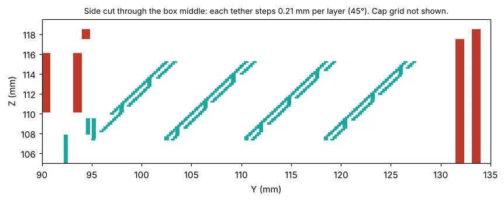
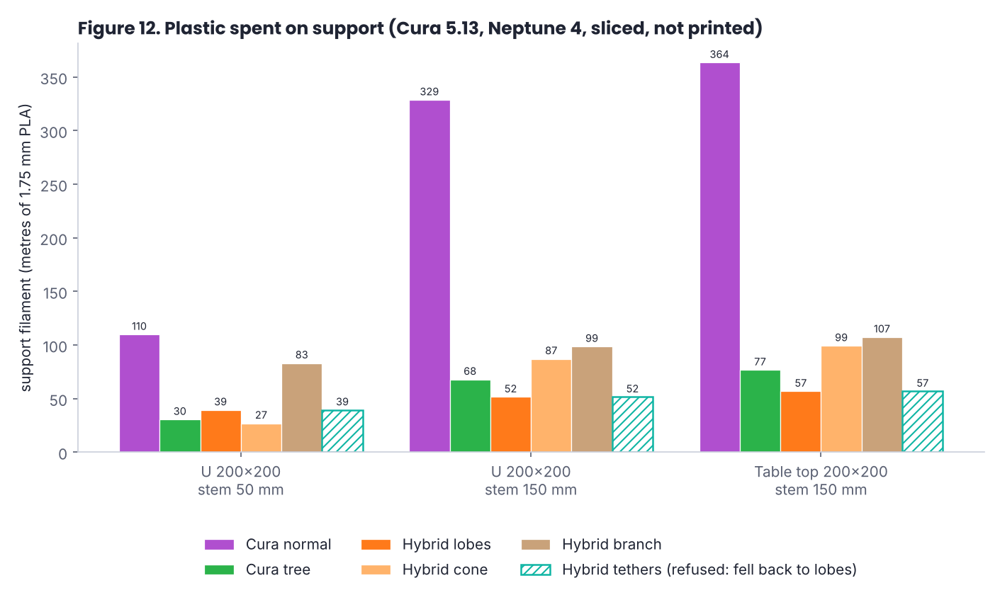

# Research notes

Everything found while building Hybrid Supports, kept with the code so it doesn't get lost. Dates are when it was checked. Anything marked *measured* was run in the test sandbox; anything marked *source* was read in the Cura, Uranium or CuraEngine code.

## 1. Paint-on supports (checked 2026-10-03)

- Cura's paint tool (`plugins/PaintTool`) has had a **"Support" paint mode since 5.11**, hidden with `visible: false` in its QML. *source*
- **Cura 5.14** (beta from 17 Sep 2026) makes the mode visible, and CuraEngine 5.14 is the first engine that reads painted support data, including for tree support. *source / release notes*
- Conclusion: a separate paint plugin would duplicate a feature that is shipping natively, so this plugin doesn't paint. On 5.11–5.13 the mode can be shown, but the engine ignores what you paint.

## 2. How CuraEngine treats a support mesh (Cura 5.11–5.13, *source* + *measured*)

The plugin adds ordinary meshes with `support_mesh = True` and `support_mesh_drop_down = False`. For every layer the engine:

1. Slices the mesh into areas.
2. Subtracts the model expanded by **Support X/Y Distance** (`support_xy_distance`). So any part of a support mesh closer to a wall than that distance is cut away. The plugin adds 0.1 mm and keeps its own geometry that far from the model (`xy_clearance`).
3. Closes small gaps (morphological close).
4. **Removes areas smaller than `minimum_support_area`.** Elegoo's base profile (`elegoo_base.def.json`, used by the Neptune 4) sets this to **3 mm²** for normal support. A 2-line tube wall or a thin spoke at one layer is often smaller than that, so whole layers vanished. **This was the "tube only printed in places / in mid-air" bug.** The plugin now sets `minimum_support_area = 0` per mesh on its own support meshes only.
5. Fills the area using the support settings:
   - With **Support Wall Line Count 0** (the default for zigzag), a thin straight slab may get no infill line at some layers, so thin spokes and rings print dashed. With **1 wall** every slab gets an outline. *measured*: box, 0 walls 5448 mm of support filament, 1 wall 7781 mm.
   - **Tree support sets `support_infill_rate` to 0** for its own branches, but meshes still use the normal support pattern.
   - The top layers of a support mesh become **support interface** if interface is on.

**Anti-overhang meshes (blockers):** the engine only removes overhang detection inside a blocker at the overhang's own layers (`support.cpp`), so a blocker has to sit over the overhang, not around the tower.

## 3. Why 0.1.x went wrong on the EN4 Rugged Box (2026-10-09)

The user's screenshots (Elegoo Neptune 4, Cura 5.x, Linux Mint) showed four problems. Root causes:

| What he saw | Cause | Fix in 0.2.0 |
|---|---|---|
| Small/complex supports print only bits of the tube, in mid-air | Elegoo's `minimum_support_area` 3 mm² deleted thin tube layers; also the landing ray hit a rib, so the tower started in mid-air | per-mesh `minimum_support_area = 0`; every tower now checks a clear column down to a flat landing (ring flatness ≤ 1 mm) |
| Big gussets protrude into the print | gussets were never checked against the model | each gusset is shortened until it is clear and has a foot; status says so |
| No pillar in the centre of the box | the trunk position was the island centroid, and the column under it wasn't checked against the walls/ribs | trunk placement searches for a clear column with line of sight to the overhang |
| Wide gap gets 3 pillars | islands were split at a fixed 30 mm "max span" | one trunk per overhang region; split only when the flare can't reach (default limit 250 mm) |

## 4. One big pillar: the head shape (2026-10-09)

The user asked for "1 big pillar with a wedge which branches across the void", then pointed out that **a hollow inverted cone** would be faster, stronger and use less material than slat branches, and then that **two diagonal lines corner to corner** might be enough to bridge from.

Checks on the rugged box (inner ceiling about 65 × 35 mm):

- A hollow cone wall is one closed loop per layer: no travel moves between branches, no retractions, and it is stiff in every direction. Slat branches each need their own start/stop.
- An X inside the cone splits the ceiling into four triangles. Printed bridges have to span the largest gap in each triangle, which is about the diameter of its inscribed circle (`2 × area / semi-perimeter`):
  - long-side triangle (base 65, height 17.5): area 568.75, semi-perimeter 69.4 → about **16.4 mm**
  - short-side triangle (base 35, height 32.5): area 568.75, semi-perimeter 54.4 → about **20.9 mm**
- 17–21 mm is a comfortable bridge for PLA on most printers, so the X is enough for this box. For bigger ceilings the plugin adds spokes at the worst gap until `2 × min(distance to nearest spoke, distance to rim) ≤ Max bridge span + grid cell` (max 16 spokes). Default **Max bridge span 20 mm**.
- Rings (concentric bands) are kept as an option for very wide flat ceilings; None is the bare cone.

*Measured* in Cura 5.13 with the Neptune 4 profile: 10 supports on the box, every trunk printed on 100 % of its layers, the X and cone visible in the layer view.

## 4b. Hollow lobes instead of cone + X (2026-10-09)

The user then suggested an inverted "pseudo cone" made of **thick hollow X-shaped lobes** instead of a cone wall plus thin X lines.

Reasoning before building it:
- Per layer, cone + spokes at radius r prints about 2πr + 4r ≈ 10.3r of line. Four lobes print about 8r (two flanks each) plus small tips: roughly 20 % less in the head.
- A lobe is a closed loop, so it gets a clean outline even with 0 support walls, where thin straight spokes printed dashed.
- No cone rim means the overhang's edges are no longer held at the perimeter. Edges that rest on a wall of the model are fine; free edges need their own lobe. On the box this adds a fifth lobe towards the open front edge (its midpoint is about 15 mm from the corner lobes' axes).

*Measured* on the test box in Cura 5.13, Neptune 4 profile, 0.2 mm, Cura's estimates:

| Head | 0 support walls | 1 support wall |
|---|---|---|
| Lobes | 149.4 min, 4907 mm support | 167.8 min, 7456 mm |
| Cone + cross | 150.6 min, 5448 mm | 169.0 min, 7781 mm |
| Cura tree support | 150.9 min, 6533 mm | |
| Cura normal support | 190.0 min, 22314 mm | |

Lobes save about 10 % of the support filament compared with the cone, and about 25 % compared with tree support. The time saving is small (about a minute) because most of the print time is the box itself. The layer plot shows each lobe as a closed loop at 0 walls. Lobes became the default in 0.3.0.

## 4c. Single-line X ribs (2026-10-09, tried and dropped)

Idea: the cheapest possible head would be four single-line ribs flaring at 45° from the trunk, with the ceiling bridged between them.

*Measured* on the test box, Cura 5.13, Neptune 4 profile (same layout rules as the lobes: ribs to the corners, more where a bridge would be too long; the ceiling needed 8 ribs):

| Ribs | Support walls | Result |
|---|---|---|
| 1 line (0.4 mm) | 1 | 143.8 min, 4733 mm, but **Cura printed no ribs at all**, only the trunks. The numbers look cheap because the head is missing. |
| about 3 mm (thickened so Cura keeps them) | 0 | 144.5 min, 4754 mm, but the ribs come out as broken zigzag patches, and some are missing |
| 2 lines (0.8 mm) | 1 | 154.8 min, 6543 mm; clean ribs, each printed as a thin loop |
| Lobes (for comparison) | 0 | 149.4 min, 4907 mm; clean closed loops |

Why: Cura doesn't print a support mesh as drawn. It shrinks each support area by half a line before laying down walls or infill, so a one-line slab disappears. The narrowest rib Cura prints cleanly is a 2-line loop, which is exactly what each side of a lobe already is. A lobe gives an 8 mm wide landing for the same two lines, and it needs no support walls, which cost time on every other support too. So ribs are never cheaper than lobes in Cura, and the idea was not kept. (Not checked: whether *Support Wall Line Count* can be set per mesh; if it can, ribs could get 1 wall while everything else stays at 0.)

## 5. Geometry notes

- **Overhang test:** a face needs support when `-n_z > cos(support angle)`, the same meaning as Cura's *Support Overhang Angle*.
- **Inside test:** count signed ray crossings along +Z (winding number). Works with overlapping shells, which a parity count gets wrong. Rays are nudged by ~1e-4 mm to stay off shared edges.
- **Flare limit:** at 45° the cone can reach `height × tan(45°)` out from the trunk. If it can't reach the region, the region is split and each half gets its own trunk.
- **Low overhangs** (≤ 6 mm above what's below) are too short for a trunk and cone; they get standing webs instead.
- **Trunk radius:** `clip(0.25 × reach, 2, 8)` mm. Lobe width = `clip(trunk radius, 4, 10)` mm.
- **Lobe outline:** in polar form around the trunk, a lobe at angle a, half-width h and length L reaches `min(h / sin|θ−a|, L / cos|θ−a|)` in direction θ. Sampling 180 directions puts the vertices exactly on the straight sides, so the sides stay straight. The inside wall is a miter offset of that outline.

## 6. Test sandbox findings (not about the plugin itself)

- Cura AppImages under Xvfb with software rendering slice fine, but the engine started at boot with the **Sentry crash reporter on ran out of memory (killed, -9)** on every slice. Running with `USE_SENTRY=0` and restarting the engine before the first slice fixed it. A normal desktop is unlikely to hit this; it's a constraint of the small sandbox.
- Cura's settings stack can report `wall_line_count 0` for a moment at startup; the harness waits for real values.

## 7. Why support meshes and not an engine fork

Cura plugins are Python and can't change how CuraEngine generates support, but the engine treats support meshes as support: they print even with *Generate Support* off, using your support line width, speed and interface settings. That keeps the plugin installable on any Cura 5.x without a custom engine.

## 8. Arc and wave overhangs (2026-10-09)

Both print a ceiling with **no support under it**, by growing the first layer sideways from an edge that is already printed.

- **Arc overhangs** (Steven McCulloch, 2022): the ceiling's first layer is laid down as concentric arcs, each one resting on the previous one. Implementations: a PrusaSlicer post-processing script by Nicolai Wachenschwan, which swaps "bridge infill" for arcs, and the SuperSlicer fork SuperPleccer. CNC Kitchen's tests needed 1–2 mm/s, a lot of tuning and tricks against warping. His view: useful for some parts, not a replacement for supports. Leaves a small dimple at the centre of each arc.
- **Wave overhangs** (paper in *Additive Manufacturing Letters*, mid-2026; Orca Slicer fork at waveoverhangs.com): like ripples on a pond spreading from the supported edge; they go round holes and corners. Reported: up to 66 % less sag than arcs, a demo part with 39 % less material than a supported print, overhang region at about 2 mm/s and about 72 % longer to print. Some more warping, and little real-world testing yet.
- **In slicers:** Cura has neither. PrusaSlicer and OrcaSlicer have "extra perimeters on overhangs", which adds overhang perimeters over steep overhangs and bridges that can't be anchored. Their documentation doesn't say whether it is based on arcs.

**For this plugin:**
- A Cura plugin can't change how Cura prints the model's own layers. Arcs or waves would have to be a **G-code post-processor** that rewrites the first layer over each overhang. That is a separate piece of work (the same kind as Shift-LoK's G-code post-processing), and it would need its own clean-room code. The licences of the existing arc and wave code haven't been checked here.
- **Cost on the test box:** the ceiling is about 65 × 35 mm, roughly 5.7 m of 0.4 mm path at 2 mm/s, so about 47 minutes for that one layer. The lobes' support filament (4.9 m) prints much faster than that, so arcs or waves would save plastic but not time on this part.
- **Combining them:** the lobes' tops would make ideal anchor lines for arcs or waves, so each arc only has to grow about 10 mm instead of 30–35 mm. That would be a possible later phase.

Sources: [CNC Kitchen: Arc Overhangs in PrusaSlicer](https://cnckitchen.com/blog/arc-overhangs-in-prusaslicer), [All3DP: arc overhangs script](https://all3dp.com/4/printing-with-arc-overhangs-is-now-easier-than-ever/), [Fabbaloo: wave-based toolpaths](https://www.fabbaloo.com/?p=238439), [Hackaday: More on wave overhangs](https://hackaday.com/2026/08/16/), [OrcaSlicer wiki: overhang settings](https://www.orcaslicer.com/wiki/print_settings/quality/quality_settings_overhangs).

## 9. Other cheap options, and tethers to the walls (2026-10-09)

The user's observation: when supports fail, the loose "fuzz" often catches on nearby walls and, within about 10 mm, builds up into something solid. His idea: deliberately string a few tethers to nearby walls about 10 mm under the overhang on each layer, then build a solid cap, with no pillar from the floor.

### Cheap options looked at

| Option | What it is | Verdict for a box ceiling |
|---|---|---|
| Reorient the part | Lay the box open side up | No support at all, if the part's design and strength allow it. Always the cheapest. |
| Plain bridging | Let Cura bridge the ceiling with tuned bridge settings (slow, 100 % fan) | Guides put clean bridges at under 20 mm and visible sag at 50–80 mm. The box ceiling only has walls 65 mm apart (the front is open), so it's too long. |
| Cura tree support | Branches from the plate | Measured: 151 min, 6.5 m of support. |
| Lobes (this plugin, default) | One pillar plus hollow lobes | Measured: 149 min, 4.9 m. |
| Lightning-style support | Cura's *lightning infill* grows branches only where top surfaces need them, and anchors them to the walls inside the part (a reported test: 43 % less material, 25 % faster than cubic infill). It's the same idea as tethers, but it only works inside a part, not for support in open cavities. | Shows that wall-anchored, grown-only-where-needed structures print reliably. |
| Arc / wave overhangs | See section 8 | Saves plastic, not time; needs a G-code post-processor. |
| **Tethers to the walls** | The user's idea, below | Measured: 136 min, 3.9 m. Experimental. |

No slicer seems to offer wall-tethered support for open cavities; none turned up in this research.

### How tethers work in the plugin

- For each overhang, the plugin tries 12 directions and looks for two walls of the model facing each other. It needs walls at both ends of most strips, at the first tether layer and at the top, and keeps the direction with the shortest span (up to 120 mm).
- Strips are 3 mm wide and 8 mm apart. They start 10 mm under the overhang. The top 2 mm is a full-width cap.
- Cura's zigzag fills each strip as a "rope" whose ends touch both walls. The layers above lay down on the rope and the walls, and the cap is printed as support roof.
- Overhangs with no facing walls, such as the box's outside ribs (one wall only), fall back to lobes.

### CuraEngine findings (Cura 5.13, *source of settings* + *measured*)

- *Support X/Y Distance* decides how close any support gets to a wall. It is **limited to the support extruder**: Cura's definition lists it as settable per mesh, but a per-object value on the model is ignored. We tried it: the value was stored on the model, but the stack's value stayed 0.68 mm, and the G-code still had a 0.7 mm gap. A per-mesh value on the support mesh is ignored too. Only the global/extruder value works.
- With *Support X/Y Distance* = 0 globally, the tether lines in the G-code touch the walls: a 0.03 mm edge gap on the first mid-air layer. So the plugin sets it to 0 for tethers (and puts it back on Remove). Its other supports keep their clearance in their own shape, built from the user's original value.
- *Support Roof* is also extruder-wide, so turning it on for the tether cap gives the lobes a roof too. The Elegoo profile's roof density is 33 %, printed as a grid.
- Single-line strips don't survive Cura's support processing (section 4c), so the strips are 3 mm wide.

### Zigzag vs straight tethers

The first tether slice printed each strip as a zigzag. The user pointed out that a straight wall-to-wall line would bridge far better: a straight line is pulled tight between two anchors, while a zigzag is a chain of short diagonal pieces joined at unsupported corners, more like a spring.

- Cause: Elegoo's profile sets *Support Infill Line Directions* to **65°**, so Cura's lines crossed the strips.
- *Measured* direction convention in Cura 5.13 G-code: angle 0 draws support lines along **Y**, 90 along **X**, and 45 at 45°. So lines along a strip at angle *a* (the plugin's XY, which matches the G-code's) need a Cura angle of 90 − *a*.
- With the angle set to 90 for the box's X-direction strips, every strip prints as a straight out-and-back pair of lines touching both walls. 0° gave square waves across the strips.
- It's one setting for the whole print, so all tethered overhangs on a part use the direction chosen by the biggest one. Overhangs that can't be tethered in that direction fall back to lobes.

### Leaning tethers

The user wanted tethers that step sideways each layer, so they're easy to cut off instead of a solid wall 10 mm high and one line thick. He suggested a step of 2 line widths per layer.

- A 0.42 mm line moved 0.84 mm lands completely beside the line below. Every layer would then be a new 63 mm bridge hanging from the walls only, and nothing would build up toward the cap. Even 1 line width only touches edge to edge.
- Half a line width (0.21 mm at 0.2 mm layers) is a 45° lean: each line sits half on the one below, the same rule as a 45° overhang. It is the default; *Step per layer* changes it.
- How: each strip is a sheared block. The plugin checks the walls at the bottom and at the top position and keeps the top of the strip under the overhang. Strips are 3 line widths wide, so Cura prints each as a pair of lines. Cura's fixed support-line grid sometimes adds a short vertical line inside a strip.
- *Measured* in the G-code: each strip's pair of lines moves about 0.2 mm per layer (for example y 102.52 / 103.14 → 103.36 → 103.56 → 103.78).

### Measured on the test box (Cura 5.13, Neptune 4 profile, 0.2 mm)

| Head | Print time | Support filament |
|---|---|---|
| **Tethers, leaning 0.21 mm per layer (default)** | 134.0 min | 3901 mm |
| Tethers, straight lines standing straight up | 135.8 min | 4334 mm |
| Tethers, zigzag lines (profile's 65° direction) | 136.0 min | 3921 mm |
| Tethers with Cura's default X/Y distance (strips stop 0.7 mm short of the walls; would not hold) | 132.5 min | 3524 mm |
| Lobes | 149.4 min | 4907 mm |
| Cura tree support | 150.9 min | 6533 mm |

### Unknowns before trusting it

- The first tether layer is a 63 mm bridge printed at normal **support speed**; Cura's bridge settings don't apply to support. It may sag or get dragged by the nozzle. The user's experience says the layers above recover within about 10 mm, which is why *Tethers start* defaults to 10 mm.
- Where the strips touch the walls they will leave marks.
- Setting *Support X/Y Distance* to 0 also lets Cura's own automatic support (if switched on) touch the walls everywhere.

Sources: [Fabbaloo on Cura's lightning infill](https://www.fabbaloo.com/news/ultimaker-curas-secret-lightning-infill-really-works), [QIDI bridging guide](https://qidi3d.com/blogs/news/3d-printing-bridging-techniques-guide), Cura 5.13 `fdmprinter.def.json` (setting flags), and the G-code measurements above.

## 10. First real print, staggered tethers and spiderweb (2026-10-13)

### What the first print showed

The user printed the stepped-tether test box:
- **The tethers were too sparse,** so much of the cap was unsupported. The leaning strips had to fit under the overhang at the top too, so only 3 strips, 8 mm apart, held a 55 × 33.5 mm ceiling.
- **The roof lattice touched the walls.** *Support X/Y Distance* was 0 for everything, the roof included.

He asked for straight tethers covering 20 % of the space, equally spaced, staggered half a line every layer; for the cap to stay supported all over; for spiderweb supports to be investigated; and for a simpler test bed: a U channel with 3.5 mm walls and roof on a big 0.4 mm brim.

### Changes

- **Coverage:** strip width 3 support lines (1.26 mm). Pitch = width ÷ 0.20 = 6.3 mm, spread evenly across the overhang. On the 40 mm test channel that gives 6 strips (19 % coverage), 5.4 mm gaps for the cap to bridge.
- **Cap clear of the walls:** the cap is the overhang outline inset by the user's original X/Y distance (+0.1 mm). Cura no longer cuts it back, because X/Y is 0, so the shape does it.

### Why the stagger needs G-code post-processing (*measured*, Cura 5.13)

- **Try 1:** strips built as one-layer slabs, with every odd slab moved 0.21 mm. The G-code had identical lines on every layer.
- **Try 2:** the same slabs offset by a quarter layer, so no slicing plane falls on a slab boundary. Still identical lines.
- The printed strip came out narrower than either slab, about the width of their overlap. So Cura slices support meshes at both the bottom and the top of each layer and keeps what they share (like *Slicing Tolerance: Exclusive*). Two neighbouring layers then always see two slabs, and a per-layer zigzag in the shape can't come through.
- **Zigzag support lines sit on a fixed grid.** Moving a strip by 0.2 mm doesn't move the lines unless an edge crosses a grid line (this explains the irregular steps seen in 0.4.1). The concentric pattern follows the strip outline exactly, so tethers now use it.
- **The fix:** `HybridSupports/tether_gcode.py`. After slicing, on every odd layer inside the tether height, it moves each SUPPORT move inside a tether strip (and the travel leading into it) across the strip by half a line width. It works on the whole G-code at once, because the travel into a layer's first strip is written at the end of the previous layer's chunk. It hooks `OutputDeviceManager.writeStarted`, the same signal Cura's Post Processing plugin uses, and marks the file so it's never applied twice.
- **Result:** on the test channel, odd layers' tether lines sit at y + 0.21 mm (98.17 / 99.01 → 98.38 / 99.22 and so on), with no crooked lines.

### Spiderweb: research

- No slicer has spiderweb supports. PrusaSlicer's bridge infill always goes straight across; spiral bridging was asked for and the answer was no. Its "extra perimeters on overhangs" is the nearest thing.
- Research on 3D-printed spiderwebs (arXiv 2509.05855, 2025) prints TPU webs **flat** and hangs them up afterwards. The authors say printing suspended cable networks isn't feasible with planar FFF printing. So there's no proven method to copy.
- How a spider builds is still a useful order for FDM: first threads across the gap, then a spiral laid across them, each piece resting on threads.

### Spiderweb: prototype in the plugin

- Threads through the overhang's centre at 6 angles; only those with walls at both ends are kept (3 on the channel). The threads start at *Tethers start*.
- Rings spaced like the tether pitch start 1 mm higher. Ring arcs not tied to a thread or a wall at both ends are dropped; before that rule, some arcs hung loose in the corners.
- It uses the concentric support pattern so the threads go in any direction.
- *Measured:* Cura joins overlapping threads and rings into one outline, so the web prints as linked loops (cell outlines), not separate threads and rings. Test channel: 28 min / 1.05 m support, against tethers 26 min / 1.04 m.
- **Verdict (superseded: see section 11, Cura's 2 mm join distance was the cause of the linked loops):** in Cura it is more complicated than straight tethers, with no gain shown so far. A true web (threads first, then a spiral laid across them as separate bridges) would need the toolpaths written directly in G-code. Kept as an experimental option to print once.

### Test bed

`tests/models.py: u_channel()`: two 3.5 mm legs and a 3.5 mm roof, a 40 × 40 × 16 mm space under it, open underneath and at both ends, on a 0.4 mm brim plate 10 mm wider all round.

Cura 5.13 estimates on the Neptune 4 profile:

| Support | Print time | Support filament |
|---|---|---|
| Lobes | 27.2 min | 0.78 m |
| Tethers | 25.5 min | 1.04 m |
| Spiderweb | 27.6 min | 1.05 m |
| Cura normal support | 26.2 min | 1.67 m |
| Cura tree support | 29.8 min | 0.89 m |

Sources: [arXiv 2509.05855: Programming tension in 3D printed networks inspired by spiderwebs](https://arxiv.org/pdf/2509.05855), [Prusa forum: spiral bridge infill](https://forum.prusa3d.com/forum/prusaslicer/make-bridge-infill-spiral-outwards), [Structural optimization of 3D-printed synthetic spider webs](https://www.ncbi.nlm.nih.gov/pmc/articles/PMC4479035/), and the G-code measurements above.

## 11. Other cheap supports, radial tethers, slow bridges and arc overhangs (2026-10-16)

The user asked for other experimental cheap supports (cheap in material or in time), including radial tethers from a corner when only two walls are there, and then for arc overhangs to be looked at as support or as tether overhangs.

### What "radial" means (his drawing)

My first reading was spokes from a corner with arcs between the walls (the "corner fan", 0.6.0 development). He rejected it: round hubs printed in mid-air, and not load bearing. His drawing shows something else: two walls at a right angle, and a short patch near the far end of one wall (the "red box", about 20 % of that wall's length) from which straight tethers fan out to points spread along the other wall. A second message added: the next hub can be the opposite wall, so the second fan criss-crosses the first and covers the whole corner.

### Radial tethers: how it works and what it covers

- The corner is found on a grid under the overhang (a free spot with walls close by in two directions about 90° apart); the sector's edges are the wall directions. Each wall's length under the overhang is measured.
- A patch of 20 % of one wall's length, at its far end, sends one straight strip to each of n points spread evenly along the other wall (n = wall length ÷ strip pitch, 6.3 mm). A second fan does the same from the opposite wall. On the 40 mm test corner that is 5 + 5 tethers. Each strip is checked to end on the wall it aimed at; the patch end is a thick root where the strips overlap.
- Wall-to-wall strips can only lie in the triangle between the two walls and the line joining their far ends. A **square roof's far corner is out of reach of any such strip** (the drawing's triangle is not the whole roof). The cap covers what is within 1.6 strip pitches of a strip (77 % of the test roof); the remainder gets a normal lobes unit.
- Plain parallel tethers on the same corner are worse than none: the first slice showed 4 diagonal strips covering the near half and nothing under the far half. Tethers now refuse an overhang when more than 10 % of it is farther than 1.5 pitches from every strip, and lobes take over.

### Slow bridging for the first layers (the biggest risk from the first print)

- The first tether layer is a bridge in mid-air, but Cura prints support at the support speed (165 mm/s on the Neptune 4 profile) and its bridge settings don't apply to support.
- MakerWorld's "Unsupported Bridge Experiments" (45 mm bridge, X1C): recommended bridge flow 1.5 and bridge speed 10 mm/s, with the part fan at 100 %; a 300 mm span is shown at 10 mm/s and flow 2 (image only, no measurements). Slower speed reduced sagging, higher flow helped adjacent lines bind, lowering the temperature and turning the bridge direction did not help. Whether wall anchors or thicker walls help was left open. Arc-overhang tests need 1–2 mm/s (see below).
- `tether_gcode.slow_bridges` now slows the first two tether layers to *Bridge speed* (20 mm/s by default), raises the part fan to 100 % and puts both back; flow is 1.0 by default (*tether_bridge_flow*), because the 1.5 result was for several adjacent lines, not single strips, and is untested here. Extrusion is absolute (M82), so extra filament is carried through every later E value.
- Cost, measured on the G-codes: +0.7 min on the channel, +0.6 min on the L corner, +0.4 min on the spiderweb.

### Cura merges support areas closer than 2 mm (*measured*, found in the radial slice)

The first radial slice showed one filled-looking triangle with scalloped edges instead of ten strips (23 min, 0.80 m of support; those numbers were wrong and are not used). *Support Join Distance* is 2 mm by default: Cura joins support areas closer than that, and the fanned strips are closer than 2 mm over their first 10–15 mm from the patch. The plugin now sets it to 0.2 mm (changed on the global stack and put back on Remove, like the other settings) for the radial and spiderweb heads. With that, the radial slice is a criss-cross lattice of separate straight strips with the patch ends overlapping, and the **spiderweb is now a real web**: three threads across first, then complete rings and spokes above them, where section 10 had linked loops. Both cost more than the merged versions did (the merged triangle was hiding material).

### The cap stack (design, 0.6.0-wip)

*The idea (user's):* the cap over the tethers should be a stack, not one roof pattern: two lattice layers, then rings with an open middle, then a solid diagonal layer. The worry is heat: a 210 °C bead laid across a one- or two-line-wide strip hanging in mid-air can soften it, melt through it or push it down, and a roof pattern that lingers on one spot (a dense zigzag, a long solid fill) makes it worse. Under-extruding the first lattice layer is meant to leave a rounder bead that fuses with the tether instead of being squashed onto it.

*What it does:* Cura's roof settings are extruder-wide (one pattern, one density), so the plugin sets Support Roof to 0.8 mm (four layers) and, when the file is saved, `tether_gcode.cap_stack` replaces Cura's roof moves inside the cap outline with its own: layer 1 a zigzag lattice across the tethers (3 mm spacing, *Cap flow* 85 %), layer 2 a lattice along them, layer 3 concentric rings at 50 % fill (line gap equal to line width) stopping when the middle is narrower than 8 mm, layer 4 a solid 45° hatch (line gap equal to line width) that bridges the open middle. Cura's roof lines give the extrusion per mm; retraction and absolute E follow the file. Sliced layers (tether channel and radial corner) are in `test-prints/`.

*Measured in the G-code (Cura 5.13, Neptune 4 profile):* on the 40 mm channel the cap filament falls from 0.39 m to 0.21 m, the whole support from 1.04 m to 0.95 m; on the 100 x 100 mm channel tethers 6.8 to 6.2 m, stepped 6.6 to 5.6 m, spiderweb 5.8 to 5.1 m (a 0.8 mm cap instead of 2 mm, so the strips run 1.2 mm higher but the cap is a third of the filament). A rough path-length estimate puts the stack 3 to 5 minutes quicker than the old cap on the 100 mm channel. Cura's own estimate cannot see the stack (it is written after slicing), so the minute figures in this file for tethers are Cura's number with that adjustment. Retraction bookkeeping was checked on the output (no extrusion while retracted, no unbalanced prime).

*Not known:* every claim in the first paragraph. Whether 85 % is the right first-layer flow (70 % may leave gaps in the lines that bridge between tethers; 100 % may cut the strips), whether 3 mm lattice spacing is right, whether the open-middle rings help or only cost time, and whether the final diagonal layer bridges an 8 mm hole cleanly. These are parameters (`tether_cap_flow`, `tether_lattice_pitch`, `tether_ring_density`, `tether_cap_hole`); the test channel in `test-prints/` is the cheap way to compare them. Cura's preview shows plain roof lines, not the stack.

*Found while testing:* a cap outline from a large part had 0.1 to 0.3 mm corner edges left by offsetting, which made the edge half-planes cut everything away and crash the save; the outline is now cleaned (hull, no tiny edges) and a failure leaves Cura's roof alone.

### Big parts: 100 x 100 mm overhangs, 100 and 150 mm tall (*measured in Cura 5.13*, Neptune 4 profile)

Smaller test parts exaggerate the fixed costs, so every head was sliced on four bigger parts: the U channel with a 100 x 100 mm roof underside (legs 3.5 mm, roof 3.5 mm) and the L corner with a 100 x 100 mm roof (two walls), each 100 mm and 150 mm tall (`models.u_channel(span=100, length=100, height=H)`, `models.l_corner(arm=100, height=H)`). Time is Cura's estimate for the whole print (the model is the same in every row, so only the differences matter). These tables were sliced before the cap stack existed: with it, the tether, stepped and spiderweb rows lose about 0.6 to 1 m of filament and, by a rough estimate, 3 to 5 minutes, while the slow first tether layers add 2 to 4 minutes that Cura's estimate misses. Support is the filament length spent on support moves, summed from the G-code (1 m of 1.75 mm PLA is about 3 g). Cura's own rows were sliced with Support Roof off, 5 % zigzag (sparse) and tree with the same overrides. `tools/bench_summary.py` makes the tables.

| Channel 100 x 100 | 100 mm tall: min | m | 150 mm tall: min | m |
|---|---|---|---|---|
| Spiderweb | 177 | 5.8 | 223 | 5.9 |
| Stepped tethers | 175 | 6.6 | 221 | 6.7 |
| Tethers (radial fell back to these) | 176 | 6.8 | 222 | 6.9 |
| Lobes | 202 | 7.2 | 252 | 7.6 |
| Cone | 229 | 14.0 | 279 | 14.5 |
| Branch | 220 | 14.5 | 269 | 14.9 |
| Trapezoid / conform | 204 | 15.9 | 254 | 16.4 |
| Cura 5 % zigzag, no roof | 223 | 23.1 | 305 | 34.7 |
| Cura tree | 357 | 28.0 | 467 | 41.3 |

| Corner 100 x 100 | 100 mm tall: min | m | 150 mm tall: min | m |
|---|---|---|---|---|
| Lobes (tethers, stepped and spiderweb all found no walls to string between and fell back to these) | 188 | 7.4 | 232 | 8.0 |
| Trapezoid / conform | 186 | 14.5 | 230 | 15.1 |
| Branch | 202 | 13.4 | 246 | 14.0 |
| Cone | 210 | 13.1 | 254 | 13.8 |
| Radial tethers + lobes (20 tethers reach 54 % of the roof; lobes take the rest) | 213 | 14.5 | 259 | 15.4 |
| Cura 5 % zigzag, no roof | 201 | 21.5 | 274 | 32.3 |
| Cura tree | 327 | 26.0 | 407 | 33.9 |

What this says (about the slices, not about prints):
- **On the channel the tether family wins at this size.** About 12 % less time than lobes and 5 to 20 % less filament, and 3 to 5 times less filament than Cura's sparse support (and the sparse roof-less support has no roof). The small-part result (lobes cheapest) reverses once the strips are long and the pillars would be many.
- **On the corner, lobes win and radial loses.** The 100 mm roof corner is too far from the walls: 20 radial tethers reach only 54 % of the roof and the lobes unit for the rest makes the total double the lobes alone. Tethers, stepped and spiderweb refused the corner outright (correctly: the strips would cover half of it).
- **Cone and branch cost twice the lobes** on these roofs; trapezoid and conform produced identical output (the roof is flat, so both build the same head).
- **Not shown by these numbers: whether a 100 mm unsupported tether bridge prints.** 16 strips at 100 mm span are far less forgiving than at 40 mm. That, the first-layer sag and the heat on the thin strips are the real questions for a printer test; the cap-flow option exists for the last one.

### Measured (Cura 5.13, Neptune 4 profile, 0.2 mm; Cura's estimate, support filament)

Test channel (40 × 40 mm roof, 16 mm gap):

| Support | Print time | Support filament |
|---|---|---|
| Tethers, 20 %, starting 10 mm below (0.6.0, slow first layers) | 25.5 min | 1038 mm |
| Tethers, 10 % (3 strips) | 24.2 min | 716 mm |
| Tethers, 20 %, starting only 4 mm below the roof | 24.1 min | 555 mm |
| Cura's own support, 5 % zigzag, no roof | 23.0 min | 752 mm |
| Lobes (0.5.0 measurement) | 27.2 min | 780 mm |
| Cura normal / tree (0.5.0 measurement, default settings) | 26.2 / 29.8 min | 1670 / 890 mm |

L corner (two walls, 40 × 40 mm roof, 16 mm gap):

| Support | Print time | Support filament |
|---|---|---|
| Lobes | 20.4 min | 231 mm |
| Cura normal, default settings | 22.8 min | 1415 mm |
| Radial tethers + lobes for the far corner (join distance 0.2 mm) | 26.0 min | 1055 mm |
| Corner fan (dropped) | 23.9 min | 875 mm |
| Cura tree | 25.7 min | 730 mm |

Same corner, 60 mm tall: radial 48.5 min / 1407 mm, lobes 45.6 min / 1025 mm.

Spiderweb on the channel (join distance 0.2 mm): 27.8 min / 1182 mm of support.

What this says, plainly:
- **Lobes are still the cheapest support in every case measured** on the L (including the 60 mm-tall one), and Cura's own sparse support (5 % zigzag) is cheaper than my tethers on the channel. The new heads are not savings; if they are worth having it is for the reason in the user's own experience, that pillars from the plate fail and the "fuzz" catches on walls. That is a hypothesis about robustness and is still untested on a printer.
- Shorter tethers help a lot (4 mm below the roof: 555 mm against 1038 mm), which fits his observation that the layers recover within a few mm. The default stays at 10 mm until a print shows whether 4 mm holds.
- Fewer strips (10 %) is cheaper but makes the cap bridge 13 mm instead of 5 mm.
- Cura's cheap settings give no roof and sparse lines; they are a baseline for time and plastic, not a like-for-like surface.
- A bug in the panel's *Coverage* field (the limits were applied before the % to fraction conversion) made a 10 % request print 31 strips; fixed, and the 10 % row above is the repeat run.

### Other cheap options considered

| Option | Verdict |
|---|---|
| Bridges and pillars (Dumas 2014; Freire, Hornus, Perchy, Lefebvre, Eurographics 2022) | Pillars along X/Y joined by bridges. On their test model the support length did not drop (2.8 m both ways); the gain is fewer contact points. Lobes already give a pillar with few contacts. |
| Lightning-style growth from walls | Cantilever branches grown from walls only where needed. Only works inside parts in Cura; as support it would mean free-ended strips, whose first mid-air layer is a one-end-anchored cantilever. Not built. |
| One fan only | Leaves the wedge next to the patch wall without any strip. The second, criss-crossing fan covers it. |
| Spokes only, no arcs (cantilevers from a corner) | Same cantilever problem. Not built. |

### Arc overhangs as support or as tether overhangs

How they work (from the algorithm's own description, not its code): the arc script reads PrusaSlicer's G-code, finds bridge infill touching an overhang perimeter and takes the shared edge as the start line. Concentric arcs grow outward from a centre on that edge until they meet a boundary or the maximum radius; the farthest point of an arc becomes the next centre, so arcs can start on arcs. Settings it recommends: coldest possible nozzle (190 °C for PLA), full fan on the arcs, about 2 mm/s, and a lowered fan and speed for the layers above, which warp. Known limits: arcs print 0.1–0.5 mm thicker than expected, follow-up layers warp (under 2 mm is called acceptable), long arcs bulge downward, it is slow on complex models, and it was only tested with PLA and PrusaSlicer 2.5. CNC Kitchen's test agrees (1–2 mm/s, much tuning); it also notes that corner supports are the workaround when arcs fail.

`tools/arc_prototype.py` estimates the cost. Arcs lie side by side, so the line length is about (area to fill) ÷ (line width), and the full arc search on the channel roof agreed (3958 mm found, 3810 mm estimated):

| One mid-air layer filled with arcs | Arc length | At 2 mm/s | At 10 mm/s |
|---|---|---|---|
| Channel roof, arcs grown from the two legs | ~3800 mm | 32 min | 6 min |
| Same, with 1–3 tethers across for the arcs to grow from | 3450–3690 mm | 29–31 min | 6 min |
| L roof, arcs from the two walls only | ~3200 mm | 26 min | 5 min |
| Only the L's far corner left by the radial tethers | ~600 mm | 5 min | 1 min |

What this means:
- **As the whole support** (arcs growing from the walls, nothing underneath) arcs save nearly all the support plastic but add about 30 minutes on a 40 mm roof at the published 2 mm/s, more than the whole print takes. At 10 mm/s the time would be small, but nobody has shown arcs holding at 10 mm/s.
- **As tether overhangs** (arcs growing from the strips) the strips only remove 3–15 % of the area, because they are thin, so the arc time barely moves. Arcs do not make tethers cheaper; tethers make arcs no cheaper either.
- **Where they look useful:** the pocket a tether pattern cannot reach, such as the far corner of the L (600 mm, 5 min at 2 mm/s), as an alternative to the extra lobes pillar. That is the experiment worth doing, and the only one that adds a few minutes rather than tens.
- Cura can't print arcs, so this needs the plugin to write the arc toolpaths into the G-code itself, over the model's own first layer above the pocket, replacing Cura's lines there; no clean-room arc code exists in the plugin yet (the licences of the existing scripts were not checked). A quick way to see whether arcs hold on a roof like this is to slice `u_channel.stl` in PrusaSlicer with supports off and run Nicolai Wachenschwan's arc script, then compare with the tether prints.

Sources: [Freire et al., Procedural bridges-and-pillars support generation (Eurographics 2022)](https://diglib.eg.org/bitstream/handle/10.2312/egs20221025/029-032.pdf), [MakerWorld: Unsupported Bridge Experiments](https://makerworld.com/en/models/1916063-unsupported-bridge-experiments), [Arc-Overhang script by Nicolai Wachenschwan](https://github.com/nicolai-wachenschwan/Arc-Overhang), [CNC Kitchen: Arc Overhangs in PrusaSlicer](https://cnckitchen.com/blog/arc-overhangs-in-prusaslicer), the arc estimates from `tools/arc_prototype.py`, and the G-code measurements above.

## 12. First look at the sliced test plate (user review, 0.6.0-wip)

The user looked at the nine-part plate in Cura's preview (not printed) and decided:

- **Spiderweb: dropped.** Large regions of the roof had nothing under them between the threads and rings.
- **Radial tethers ("spider lobes"): dropped.** The fan of tethers plus a separate lobes tower for the far corner is the worst of both; one lobes tower sized to the area does the job.
- **Stepped ("offset slat") tethers: dropped.** No advantage over straight tethers.
- **Tethers: kept**, with the first strip at one end of the overhang and the last at the other end, offset 0.2 mm for easy removal (read as: 0.2 mm in from the overhang's edge; the half-line stagger moves the odd layers a further 0.2 mm, so those sit at 0.0 to 0.4 mm from the ends).
- **Lobes: kept**, but one tower built to size instead of four on the 40 mm block.

*One tower built to size, as built:* a trunk at the flare limit can only reach (height available) × tan(45°) beyond its own radius, so on a 40 x 40 mm roof 15 mm up the foot must be about 29 mm across. That foot is hollow, so it gets straight spokes from the centre to the rim, enough that the rim gap between spokes stays under 0.6 x *Max bridge span* (8 spokes on the channel). Sliced on the new six-part plate: channel lobes 1.09 m of support with one tower, against 1.21 m with four towers on the nine-part plate (both inflated by the plate's shared tether settings); corner lobes 0.88 m against 1.41 m. Whether the wide foot comes off in one piece is for the print to show.

*Second review (the six-part plate, in a G-code viewer):* the four branch pillars on the channel were "expensive from time and material", and the one-tower lobes' wide hollow foot with spokes was an "expensive hub; a single 2-line criss-cross should provide enough strength, far less material". Now both Lobes and Branch build a hub-less criss-cross where one tower is needed: thin walls from one centre, standing on the bed out to the radius a 45° flare needs and rising to the overhang's edges, corners first, extra walls only where a bridge would pass *Max bridge span* (edges resting on a model wall count as supported). Sliced on the six-part plate (still with the plate's shared tether settings): channel lobes 0.58 m (hub version 1.09 m, four towers 1.21 m), corner lobes 0.51 m (0.88, 1.41), channel branch 0.58 m (four pillars 0.63 m). Unknown until printed: whether 2-line walls 15 mm high, joined only at the centre, stand without wobbling.

*Third review:* "If we can't make the cone a single 1 or 2 wall cone with internal criss-cross ribs, let's drop it; it's too many head moves / plastic." Built: one thin cone to size (2-line wall, `cone_wall_lines`; 64 sides) from a circle on the bed, flaring at 45° until it meets the overhang's edges or the model, plus an X of 2-line ribs to the corners; no hub, no trunk. Plate numbers (shared tether settings): channel cone 0.92 m and 20,416 extrusion moves (four cones 0.97 m; criss-cross 0.58 m and 8,117 moves), corner cone 0.82 m and 19,322 moves (criss-cross 0.51 m, 7,603). The cone's wall supports the roof's whole edge, which the criss-cross doesn't, but costs about 60 % more plastic and 2.5 times the moves. A 1-line wall cuts the shell's volume by about a third (1,807 against 2,573 mm³ for the whole cone on the channel). Recommendation: keep the criss-cross; drop the cone unless the print shows the roof edges need it.

## 13. Zig-zag towers and too many towers (user review of 0.6.0 in Cura, 2026-10-19)

The user sliced 0.6.0 himself (Cura, Neptune 4 profile) and sent three screenshots: "the tethers are flawless, the others are bad. They generate zig-zag towers instead of hollow towers, and some generate 4 towers when 1 would do." Two of the screenshots were a channel standing on a grey base plate.

**Why zig-zag.** A Cura support mesh is only an *area*: CuraEngine fills it with the support extruder's pattern, wall count and density. In Cura 5.13's `fdmprinter.def.json`, `support_wall_count`, `support_pattern`, `support_infill_rate` and `support_line_distance` are all `settable_per_mesh: false`, so a plugin can't make *its* support meshes print as outlines without changing them for the whole job. The Neptune 4 (Elegoo base) profile leaves support walls at 0, so a thin support area prints only where the zig-zag crosses it. 0.6.0 worked round the "thin walls vanish" problem by widening every wall to support line distance + 1 line (about 3 mm), and Cura printed one zig-zag line inside each 3 mm strip, with no outline: the zig-zag towers in the screenshots, reproduced in the sandbox's Cura 5.13 on the plate channel.

Options considered:
1. Set Support Wall Line Count 1 for the whole job (like the tether settings). Clean outlines, but it changes the user's profile for every support in the job, and the 3 mm walls would still be partly zig-zag inside.
2. **Add the towers as normal printed meshes** with per-mesh settings (all `settable_per_mesh: true`): `wall_line_count` 1, `infill_sparse_density` 0, `top_layers`/`bottom_layers`/`initial_bottom_layers`/`roofing_layer_count`/`flooring_layer_count` 0, `xy_offset`/`xy_offset_layer_0` 0, `support_enable` false, line width = support line width, wall speed and flow = support speed and flow. Chosen. The thin walls go back to 2 lines and print as closed loops; tubes as two rings. Nothing global changes. Cura doesn't drop or push the meshes because they are children of the model (`PlatformPhysics` skips children for drop-down and parent/child pairs for push-free).
   Trade-offs: they show and print as *walls* (Cura's wall colour, `;TYPE:WALL-OUTER`), so a dual-extruder support material would need the mesh's extruder set by hand; Cura's own Support X/Y Distance isn't applied to them (the clearance was already built into the shape); Cura's support Z distance isn't either (the 0.2 mm contact gap is built in, as before).

**Why 4 towers.** Tracing `build_unit` on a channel standing on a 0.4 mm plate: the normal tower can't reach a 40 x 40 roof 16 mm up, so it tries "built to size"; `_place_trunk(fit=True)` found a spot, but `_criss_cross` returned no walls at all. `_build_fin` checks for model just above each wall by casting up from `min(top, foot) - 0.5`; standing on the plate, that start is inside the plate, the first hit is the plate's own top, and the wall's top was clamped to 0.2 mm, so every wall was dropped. With no walls the region was split in two, each half failed the same way, and so on: 4 towers at 16 mm, 16 to 32 at 8 mm. On the bare bed (the sandbox's plate parts) the ray found nothing, which is why the earlier tests never showed it. Separately, the round foot had to be as wide as the reach (about 29 mm across for a 40 mm roof 15 mm up), which fails as soon as the legs are closer than that.

Fix: cast from just above the foot; give each criss-cross wall its own foot along its line (`_arm_foot`: as far as a 45° flare needs to reach its end, or as far as the floor beside it is clear and level); the round foot (`_clear_foot`, used by the cone) is as wide as is clear, up to what is needed; include the landing height in that need. Keep "built to size" when it reaches 85 % of the overhang.

Results are in the changelog (0.6.1-wip). Still unknown until printed: whether 2-line walls 15 mm high, now printed as closed loops at support speed, stand and break away cleanly.

## 14. Notches and slab stiffness (user review of the 0.6.1 top view, 2026-10-23)

Looking at the 0.6.1 layer plot of the channel criss-cross (six 2-line walls meeting at the centre), the user pointed at the centre: "that stress concentrator shape is pretty terrible for 3D printing, can we fillet it or even have a straight line", and at the walls: "hollow loops are very close, which will reduce its XY strength, making it flex during nozzle drag. Can we do fewer lobes which are rounded loops which take up far more space?"

Reasoning:
- **The notch.** Where thin webs meet, the outline has sharp inner corners, which concentrate stress when the wall is pushed sideways, and Cura's wall loops turn tightly there (in the 0.6.1 G-code they pinch off into small separate loops round the centre). A rounded inner corner spreads the load and lets the wall run round in one smooth loop.
- **Sideways stiffness.** A web's bending stiffness across its thickness grows with the cube of its width. A 0.8 mm slab (two lines touching) is very flexible across; a hollow lobe whose two walls are about 8 mm apart is, as a box section, roughly (8 / 0.8)^2 = 100 times stiffer for the same wall material per unit length, ignoring the end caps. That is the resistance that matters when the nozzle drags across a 15 mm tall support.
- **Fewer lobes.** A wider lobe covers more of the roof itself, so the bridging rule (no gap longer than *Max bridge span*, edges on a model wall count as supported) is met with fewer: 4 on the 40 mm channel instead of 6.

Built: the built-to-size Lobes support is one solid star (`_petal_star`) printed hollow with 2 walls. Each lobe is a capsule of half-width w along its arm; the star's outline radius in each direction is the smooth maximum (polynomial smooth max, width = fillet) of the lobes' radii, which rounds the inner corners without moving the lobes' sides. Its foot and flare follow the 0.6.1 per-arm feet. The outline is sampled in 128 directions (about 1 mm steps at the tips) to keep the move count down; 240 directions gave about 18,000 moves per part against 14,700.

Not done: rounding the joins between the cone's ribs and its shell; Branch keeps straight webs with only a rounded hub. A thin web gets spiky ends when built from a radial outline, so the radial star is only used for the hub there.

Still unknown until printed: whether 8 mm hollow lobes with 2 walls, 15 mm tall, hold the roof without wobbling and come off in one piece.

## 15. An interface for every support (user review of 0.6.2, 2026-11-02)

"They don't have any support interface. Please make sure they all have at least 2 layers of lattice and one 100 % interface, else the part will droop."

Since 0.6.1 the towers print as walls (normal meshes), so Cura's *Support Interface* can't apply to them, and with the head's walls only touching the underside along lines, the part's first layer would bridge everything in between.

Options considered:
1. Turn on Cura's support roof for the job and make the cap a support mesh on top of the towers. Cura keeps support a *support Z distance* (one layer on the Neptune 4) above any model surface, and the towers are model to Cura, so the cap would start one layer above the tower tops, in mid-air. It would also change the user's profile.
2. **Make the cap a normal mesh of its own and rewrite its layers in the G-code.** Chosen. Two normal meshes stack with no gap, so the first lattice bonds onto the tower tops; the cap's top keeps the usual 0.2 mm contact gap to the part, like Cura's support top distance. The existing cap stack does the rewriting; it used to find the tethers' cap by its line type (SUPPORT-INTERFACE), and now finds a tower cap by Cura's `;MESH:` comment (Cura adds "(1)", "(2)" to repeated names on a plate, so it matches the prefix, plus the cap outline), so the part's own lines on the same layers are left alone.

Shape: a flat slab can only sit under a flat-ish part of the underside, so each 0.8 mm height band gets its own piece, a staircase on slopes. Pieces are convex (the cap stack's lattice and ring paths assume convex outlines); a ring-shaped band round a dome is split into 8 sectors, and each piece is cut back from the model with half-planes. The tower is planned after the caps, against the caps' undersides, so it never stops short where no cap fits. On steep curved undersides (the tilted blob test part) the bands are too narrow for a cap; there the tower still reaches the underside as before.

Still unknown until printed: whether a 3 mm lattice bridging 15 to 20 mm between the lobes at 20 mm/s holds flat enough for the next layers, and how the 0.2 mm gap under the solid layer comes off.

## 16. Big parts on long stems: how much can it save? (user request, 2026-11-10)

"Run the simulations on bigger parts, parts with a long stem, so we can get a better feel for potential savings. Perhaps a U which is 200x200."

**Method.** Three STL parts (`tools/bigbench/bigmodels.py`): a 200 x 200 x 200 mm U (two 10 mm legs, 5 mm roof) with the roof underside 50 mm and 150 mm above the bed, and a 200 x 200 table top on a single 30 x 30 stem, 150 mm. Each was sliced headless in Cura 5.13 with the Neptune 4 profile (`tests/cura_harness`): bare, with Cura's normal support, with Cura's tree support, and with Hybrid Supports lobes / branch / cone (Generate, then save with the interface caps). Support cost = the job minus the bare part, filament counted from the G-code per mesh (`bymesh.py`). Time uses a plain distance / feed-rate model (`gtime.py`) because Cura's `;TIME` leaves out the slow first-lattice layers and so flatters the Hybrid heads; 1.24 g/cm3 PLA.

| Part (bare print) | Support | Support filament | Support time (move model) | Whole job (move model) |
|---|---|---|---|---|
| U 200x200, stem 50 mm (230 min) | Cura normal | 109.8 m / 328 g | 342 min | 574 min |
| | Cura tree | 30.5 m / 91 g | 89 min (+45 travel) | 359 min |
| | **Hybrid lobes** (4 towers, 95 %) | 39.4 m / 118 g | 137 min | 374 min |
| | Hybrid cone (2 towers, 98 %) | 27.0 m / 80 g | 99 min | 343 min |
| | Hybrid branch (8 towers) | 83.2 m / 248 g | 270 min | 573 min |
| U 200x200, stem 150 mm (393 min) | Cura normal | 328.7 m / 980 g | 1009 min | 1404 min |
| | Cura tree | 67.9 m / 203 g | 202 min (+99 travel) | 666 min |
| | **Hybrid lobes** (4 towers, 95 %) | 51.5 m / 154 g | 173 min | 583 min |
| | Hybrid cone (2 towers, 96 %) | 87.1 m / 260 g | 282 min | 720 min |
| | Hybrid branch (4 towers, 95 %) | 98.6 m / 294 g | 317 min | 786 min |
| Table top 200x200 on a 30 mm stem, 150 mm (206 min) | Cura normal | 363.5 m / 1084 g | 1115 min | 1313 min |
| | Cura tree | 76.7 m / 229 g | 228 min (+77 travel) | 496 min |
| | **Hybrid lobes** (4 towers, 91 %) | 56.8 m / 169 g | 192 min | 400 min |
| | Hybrid cone (2 towers, 94 %) | 99.3 m / 296 g | 321 min | 570 min |
| | Hybrid branch (4 towers, 95 %) | 107.4 m / 320 g | 346 min | 617 min |

**Savings (Hybrid lobes).**
- vs Cura normal support: 64 % less plastic at 50 mm, 84 % less at 150 mm (both tall parts), about 60 % / 83 % less support time; whole job 35 % / 58 % / 70 % shorter (U50, U150, table).
- vs Cura tree support: *more* plastic at 50 mm (39.4 m against 30.5 m, 29 % worse), but 24 % less on the U at 150 mm and 26 % less on the table, and the whole job 12 % / 19 % faster. Tree support grows with the height of its trunks and with every extra branch needed over a 200 mm roof, and the Hybrid towers are four shells and a cap, whose cost grows slower with height.
- Short stems are the weak point. At 50 mm the caps (a full 0.8 mm sheet under 35,000 mm2, 5.2 m) are about a seventh of the support and a tree is already cheap; the saving is a tall-part effect.

**What did not work.**
- Branch (thin webs, many arms) was the most expensive head everywhere (8 towers on the 50 mm U).
- Cone is the cheapest on the 50 mm U (27.0 m, the best result there, two towers) but the flared shell is costly when tall (87 to 99 m), so it only wins on short, wide parts. Lobes is the head to use on tall parts.
- The first cone slices on the two tall parts were truncated (4 layers). Cause: `_flare_reach` took the farthest point in each direction *sector*, and on a 100 mm overhang the far corners of a 5.6 degree sector are well off the ray, so the 45 degree shell was pushed about 17 mm past the roof's edge (off the part and the bed). It now takes the reach along the ray from points close to the ray. Fixed in 0.6.4 (footprints of all three heads now stay within about 3 mm of the part).
- Along the way, a head that reaches under 85 % of its region now splits the region and tries again (up to depth 5), which is why the 200 mm parts get 2 to 4 towers rather than one that misses corners. Reach is 91 to 98 %: some corner tips are left to the 0.8 mm cap only.
- The interface cap now cuts the half-plane across the direction of the model hits (not the line to the centre), so it keeps 99 % of the hull area on the test parts (U50: 35,430 of 35,658 mm2).

**Caveats.** Sliced, not printed: nobody yet knows whether 8 mm lobes standing 150 mm tall hold a 5 mm roof without wobbling, and a 3 mm lattice bridging 100 mm between four towers may sag; if they fail the saving is zero. The move model ignores acceleration. Cura's own estimate gives different (kinder to Hybrid) numbers: lobes support 203 / 291 / 310 min against tree 300 / 504 / 555 min. Only PLA volume, no print-success rate and no removal effort were measured.

**Tethers on the big parts.** Run too (head mode *Tethers*, same three parts). All three fall back to lobes ("no walls to tether to"): a tether is a thin strip printed out from a wall of the model, and on a 200 mm U or a table top the support's footprint is far from any wall it can reach, so the result is identical to the lobes row (39.4 / 51.5 / 56.8 m of tower, same 4 units). Tethers have not been shown to save anything on parts like these; they stay a head for supports that sit next to walls (the 40 mm channel and corner on the test plate), where they are the cheapest. Whether tether strips could run from the U's legs in along the roof (a 200 mm span, ~100 mm from each leg) is untested and probably too far for a strip to stay stiff.

## 17. How far can a strip bridge? Published limits (user question, 2026-11-10)

The 120 mm `tether_max_span` has no source (it was a search distance in the first Tethers commit, 0.4.0, written for 40 to 120 mm test parts), so this is what published guidance says. Nothing here is a standard; every figure is one printer, one filament, one setup.

| Source | Span | Conditions |
|---|---|---|
| [MIT Fab Academy, week 3](https://fab.cba.mit.edu/classes/MAS.863/EECS/Week3.html) (class test) | 18 mm reliable, 20 mm slight degradation | horizontal unsupported spans, printer and filament not stated for this test |
| UltiMaker guidance, as summarised by [3D Mag](https://www.3dmag.com/3d-wikipedia/3d-printing-bridging-settings-materials-and-limits/) | 10 mm guideline; 25 mm Tough PLA example | with optimisation and active cooling |
| A 2021 dimension-error study, same page | 25 to 43 mm tested, limit 33 to 37 mm | one printer, one setup; measured deck thickness against design |
| [3DPrintingSpace](https://3dprintingspace.com/t/how-to-fix-sagging-bridges-and-poor-bridging-settings-for-clean-overhangs-bambu-lab-ender-prusa/10449) (forum guide) | 20 to 30 mm reliable, supports past ~50 mm, well-tuned setups 100+ mm | bridge speed 20 to 40 mm/s, PLA fan 100 %, nozzle 5 to 10 C cooler, bridge flow 0.85 to 0.95 |
| [Makerforums thread](https://forum.makerforums.info/t/check-out-this-bridge-distance-just-over-2-of-span-with-hardly-any-sag/41167) (hobbyist reports) | 51 mm hardly any sag; 96 mm with under 0.3 mm sag; one claim of 120 mm | 0.1 mm layers, 100 % fan through a high-pressure side duct (said to be "99 %" of the result), full print speed, PLA; the 120 mm post gives no settings |
| A 2026 PLA beam study, same 3D Mag page | no limit stated | girder width grew from 1.2 to 4.3 mm as span grew from 60 to 140 mm; qualitative only |

**What this says.** There is no established upper limit. Conservative sources say 10 to 30 mm; tuned hobbyist setups report about 100 mm; the one 120 mm report is unsourced. I found nothing for 180 mm. The factors that move the number are cooling (the biggest), layer height (thinner sags less), speed (slow, 20 to 40 mm/s), and bridge flow and temperature. Our tethers already use 20 mm/s, 100 % fan and 0.2 mm layers on a Neptune 4, which is the favourable end of those settings.

**Strips are not sheets.** All the sources above are about bridging a wide solid area. A tether is a single 3 mm strip (two lines), which has less mass to cool and sits between supported ends, and I'd expect it to bridge at least as far as one line of a sheet, but that is my reasoning, not a figure from any source. Layers 2 and 3 are shifted half a line width, so they are not true bridges but lie half on the one below.

**What was changed.** `tether_slow_layers` goes from 2 to 3 (0.6.5), so the first three tether layers print at the bridge speed (20 mm/s) with the fan at 100 %, in case the first two are weak or slack. The 120 mm limit is unchanged: it sits inside the "well tuned, 100+ mm" range and no source supports going to 180 mm without a test. The next step is a test print of strips across 100, 150 and 190 mm gaps.

**Not read.** A 2025 Politecnico di Bari paper on gravity-induced sagging and a PMC paper (PMC12845589) turned up in the search; the PMC page was blocked by a browser check and I did not read the Bari paper, so neither is used here.

## 18. Tether span limits: the sag simulation (user's sim, 2026-11-10)

Matthew's physics simulation of PLA strands bridging between walls (full note, code and plots: `tools/tethersim/`). It was fitted to published Ender 3 guidance (0.1 mm at 25 mm, 0.4 mm at 50 mm, 0.85 mm at 80 mm) with one factor, and gives conservative spans of about 70 to 90 mm for the Neptune 4 (soft walls, 20 to 40 mm/s), rising to 85 to 130 mm with rigid walls whose shrinkage pulls the strand taut. Beyond about 100 mm the limit is no longer cooling: the solid 0.32 mm strand bends under its own weight (sag grows with L^4 / d^2), a ceiling for any printer on a 0.4 mm nozzle at 0.2 mm layers. Everything is unvalidated until a span ladder is printed.

**Decision (0.6.6):** the user set the tether limits from this: **110 mm is a hard limit** (the tether head refuses, tells the user why, and uses lobes, the next best), and **over 90 mm it builds but warns** that the result is unpredictable, with the line "the vengeful Flying Spaghetti Monster may appear suddenly for trying to violate the laws of physics". 90 mm is the top of the conservative band, and 110 mm sits inside the optimistic band of the simulation.

Not adopted yet (the sim's other recommendations): per-printer span limits, tether speed by fan strength, Z following half the predicted sag on layers 2 and 3, flow 1.2 to 1.5 on layers 2 to 5. Validation print still needed: a single-strand ladder at 20 to 120 mm in 10 mm steps.

Follow-up on the Gemini answer (2026-11-10): its Neptune 4 figures (100 to 150+ mm bridges, 70 to 75 degree overhangs) are not in the Tom's Hardware review it cites (which gives no bridging distance and no overhang angle, only "extremely fast" cooling and passing bridging in a clearance test). The CC 3D Labs guide says 50 to 80 mm well tuned and over 100 mm optimised, with no mention of Ender 3 droop. Not used.
