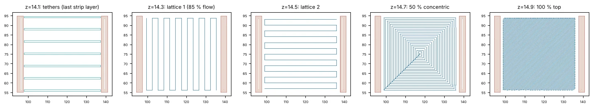
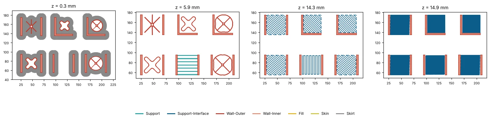

# Test print: every support on one plate

**Not printed yet.** Sliced and checked in Cura 5.13 only.

`N4_PLATE_all_supports_one_job.gcode` prints six parts in one go on the stock **Elegoo Neptune 4** profile (Generic PLA, 0.4 mm nozzle): **first layer 0.3 mm for grip, every other layer 0.2 mm, 4 walls, an 8 mm brim**, supports starting 15.1 mm up (the roof underside is 15.1 mm above the bed, which lands exactly on a layer top). Cura's estimate is 2 h 21 min and 29.3 m of filament; the cap stack and the slow first tether layers are written when the file is saved, so the estimate doesn't include them. The parts are in `plate/`: a channel (two 3.5 mm legs, a 40 x 40 mm roof 3.5 mm thick, open underneath and at both ends) and a corner (two walls in an L under the same roof).

Where each part sits (looking at the bed from the front):

| back row | p4 channel, **branch** (criss-cross) | p5 corner, **lobes** (criss-cross) | p6 corner, **cone** (one, ribbed) |
|---|---|---|---|
| **front row** | **p1 channel, lobes** (criss-cross) | **p2 channel, tethers** | **p3 channel, cone** (one, ribbed) |

**0.6.1:** the Lobes, Cone and Branch supports now print as hollow walls (Cura's wall colour in the preview, `;TYPE:WALL-OUTER` in the G-code), not as zig-zag support, so the plate's shared tether settings no longer change them. **0.6.2:** Lobes built to size is one star of 4 wide (8 mm) rounded lobes with rounded joins, printed hollow with 2 walls; Branch and the cone's ribs get a rounded hub. Regenerated with 0.6.2 in Cura 5.13.

**0.6.4:** no change to the plate; big-part benchmarks are in docs/RESEARCH.md section 16.

**0.6.3:** every support now has the 4-layer interface cap under the roof (lattice, lattice, 50 % rings, 100 %), written into the G-code on save; Cura's preview shows those layers as plain solid skin. Cura's estimate for the plate is now 2 h 21 min and 29.3 m. The per-part numbers below are from 0.6.2 and don't include the caps (about 0.2 m more each).

Support filament per part, summed from the G-code between the legs (0.6.1 method, which includes a little of each part's own first layers, so the numbers are higher than the 0.6.0 ones; on the same measure 0.6.0 gave 0.78 / 1.28 / 1.24 / 0.77 / 0.66 / 1.11 m):

| Part | Support filament | What it is |
|---|---|---|
| p1 channel lobes | 0.73 m | one star built to size: 4 hollow rounded lobes 8 mm wide to the corners, 2 walls, rounded joins, each standing on the bed along its own line and then flaring out at 45° |
| p2 channel tethers | 1.22 m | 7 straight strips leg to leg, the first and last at the two open ends (0.2 mm in), every other layer shifted half a line, then the 4-layer cap stack |
| p3 channel cone | 1.26 m | one cone built to size, no hub: a 2-line wall from a 29 mm circle on the bed flaring at 45° to the roof's edges, with an X of 2-line ribs inside to the corners |
| p4 channel branch | 1.06 m | 6 straight 3-line webs from one centre with a rounded hub |
| p5 corner lobes | 0.65 m | one star built to size: 4 hollow rounded lobes, 8 mm wide |
| p6 corner cone | 1.22 m | the same, on the corner |

**The plate skews the numbers.** Cura's support pattern, roof and X/Y distance apply to every support in a job, not per part. The tethers need X/Y distance 0, a roof and the concentric pattern, so the lobes, cone and branch parts on this plate print with those settings too, which makes their supports thicker than they would be alone (on the earlier nine-part plate, the four-tower lobes came out 1.21 m on the plate against 0.76 m alone). Use the plate to see how each style prints and comes off, not to rank their filament.

## What to look at

1. **The first tether layer** (p2, about 5 mm up). A 40 mm bridge in mid-air, printed at 20 mm/s with the fan at 100 %. Does it hold, sag or get dragged?
2. **The end strips** (p2): the first and last strip now sit at the open ends of the channel, so the roof's ends are carried.
3. **The cap stack** (p2, the four layers below the roof; Cura's preview shows plain roof lines instead): a lattice across the tethers at 85 % flow, a lattice along them, one full layer of 50 % concentric rings, then a solid 100 % top layer for a smooth underside. Does layer 1 bond to the strips or cut them?
4. **The lobes star** (p1, p5): do four hollow 8 mm lobes, 15 mm tall, stay put when the nozzle drags over them, carry the roof, and come off in one piece? **Branch** (p4): do thin straight webs with a rounded hub do as well?
5. **The one cone** (p3, p6): it carries the roof's whole edge, but costs about 60 % more plastic than the criss-cross and about 2.5 times the extrusion moves (20,400 against 8,100 on the channel). If the criss-cross prints well, the cone is the one to drop.
6. **The tower caps** (p1, p3, p4, p5, p6, 14.3 to 14.9 mm): does the first lattice, bridging between the walls at 20 mm/s, stay flat, and does the solid top layer give the roof a clean underside?
7. **Removal:** which comes off cleanest, and what marks does each leave?

The brims of neighbouring parts touch, so they print as one; take the parts off one at a time with a thin blade.

`tests/cura_harness/plate_all_supports.json` lists the parts, positions and heads the harness used. In Cura you can do the same by hand: select a model, choose its head, press Generate, and repeat for the next model (each model keeps its own settings and G-code steps).

